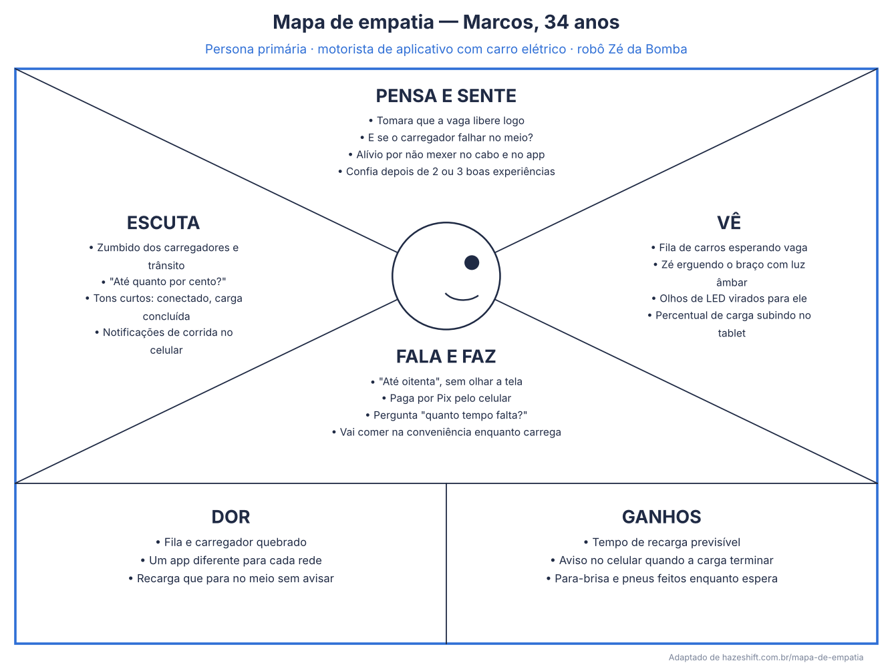
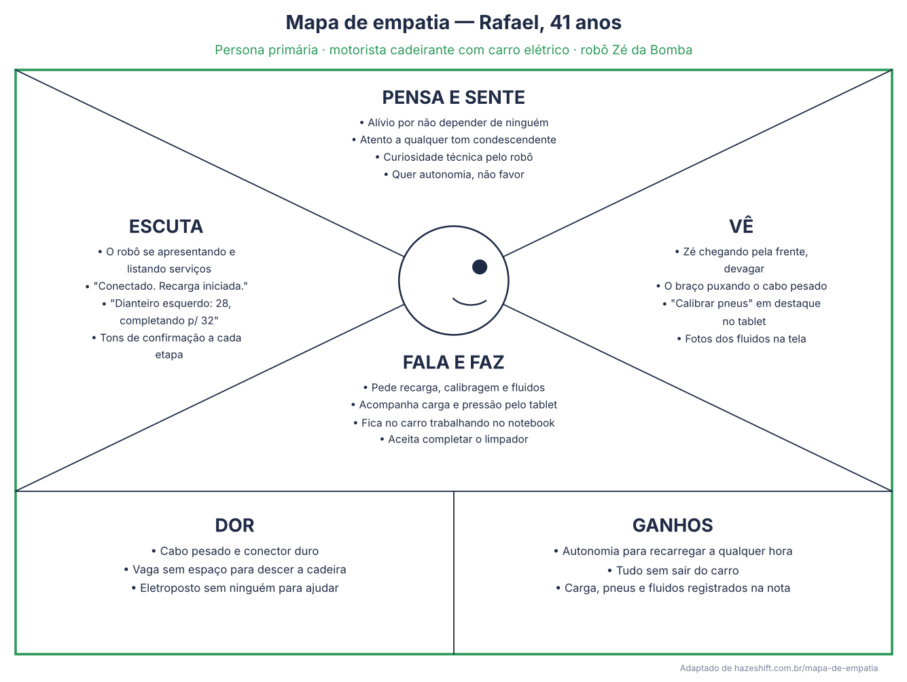
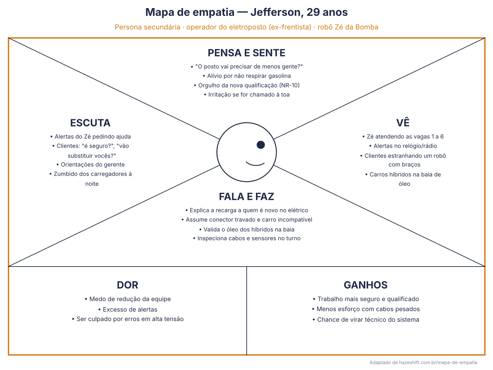
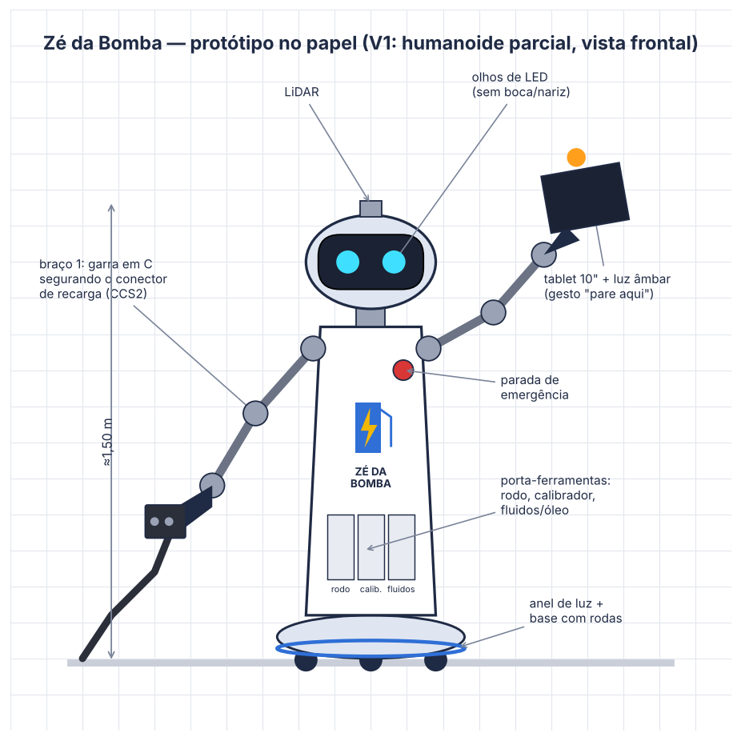
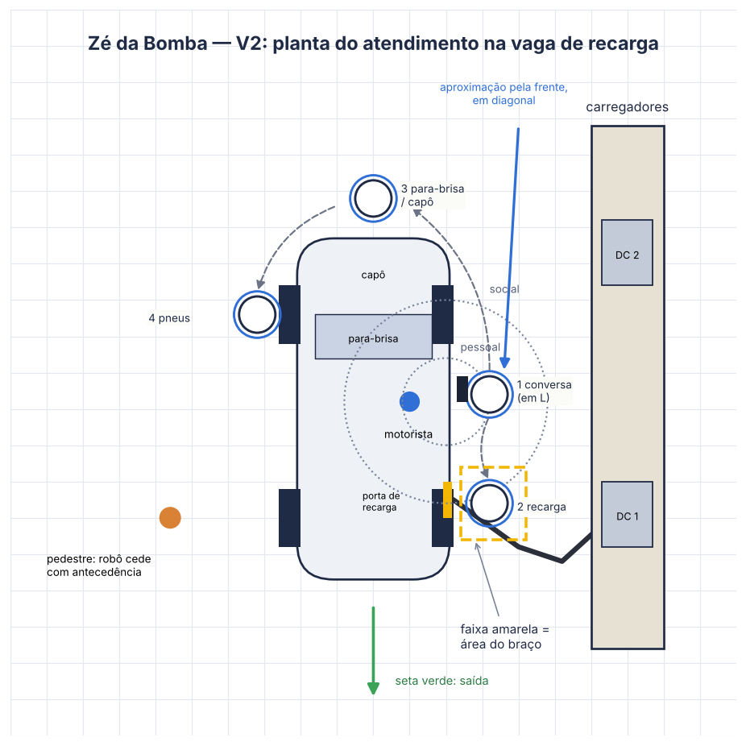
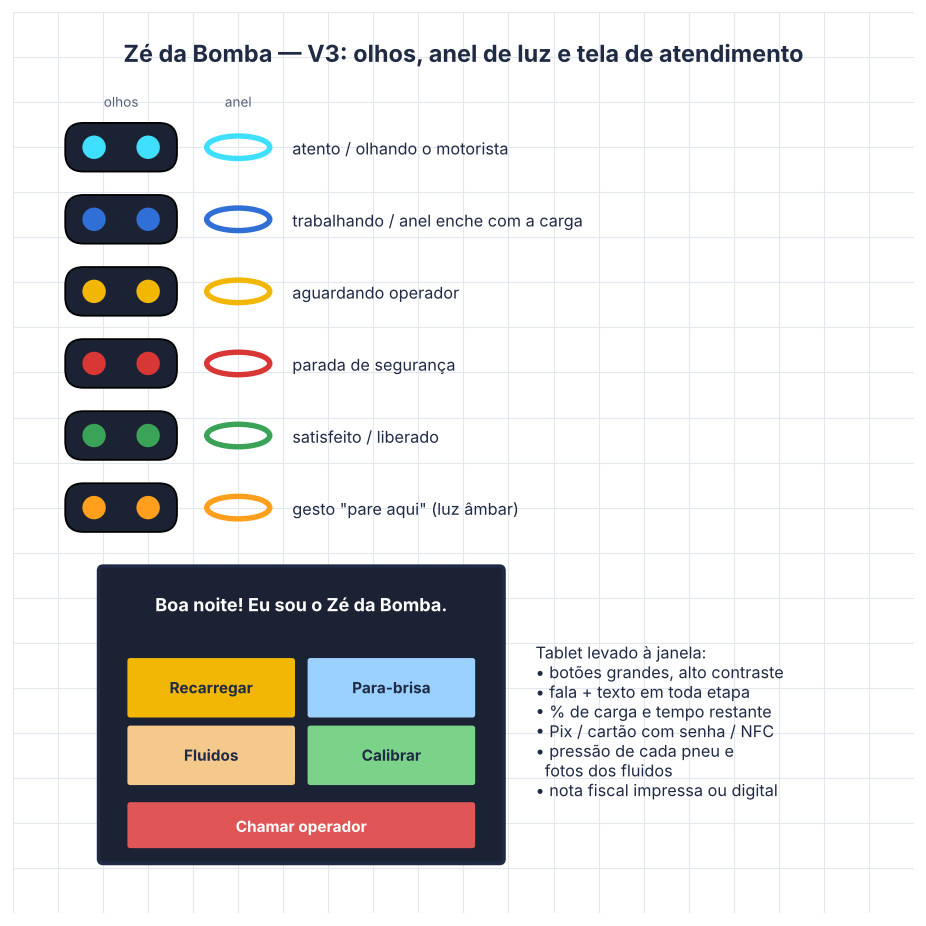

# **Zé da Bomba:** Robô atendente humanoide para eletropostos

Trabalho de Interação Humano-Robô (IHR) apresentado ao Centro Universitário [FEI](https://portal.fei.edu.br/), como parte dos requisitos necessários para aprovação na disciplina de Interação Humano-Robô (IHR) (CCR230) do curso de Engenharia de Robôs, orientado pelo Prof. Dr. [Fagner de Assis Moura Pimentel](https://github.com/fagnerpimentel).

## Componentes do Grupo

- Nome - RA
- Nome - RA
- Nome - RA

## Resumo

O Zé da Bomba é um robô atendente humanoide parcial, com cabeça, tronco e dois braços sobre uma base móvel com rodas, que trabalha em um eletroposto (hub de recarga de veículos elétricos) ao lado de um operador humano. Com um sistema de segurança elétrica em várias camadas, ele conecta e desconecta o cabo de recarga, gerencia a fila de vagas, limpa o para-brisa, verifica os fluidos do carro (e o óleo, nos híbridos plug-in, com troca na baia de serviços), calibra os pneus (atendendo principalmente motoristas com deficiência ou mobilidade reduzida, que não conseguem manusear os cabos pesados nem sair do carro) e recebe o pagamento com emissão de nota fiscal. Ele aproveita o tempo de recarga para fazer os outros serviços e repassa exceções ao operador, que supervisiona o robô.

## Introdução

A frota de carros elétricos no Brasil cresce rápido: em setembro de 2026, a ABVE contava cerca de 640 mil veículos plug-in (elétricos e híbridos plug-in) e quase 30 mil pontos de recarga públicos e semipúblicos, cerca de 11 mil deles de recarga rápida DC, com São Paulo concentrando a maior parte. Muitos postos de combustível de bandeira estão abrindo áreas de recarga, e a REN ANEEL nº 819/2018 permite que qualquer estabelecimento venda recarga a preço livremente negociado.

A recarga, porém, ainda tem barreiras de uso. Os cabos de recarga rápida são grossos e pesados, e os conectores (CCS2 e Tipo 2) exigem força e precisão para encaixar, o que é difícil para pessoas com deficiência, idosos e quem tem pouca força nas mãos. A maioria dos eletropostos é autosserviço, sem ninguém para ajudar; cada fabricante usa um app diferente; e a recarga rápida leva de 20 a 40 minutos, um tempo "morto" em que o motorista fica esperando. Ao mesmo tempo, os postos que se convertem em hubs de recarga precisam de um novo papel para os frentistas, cuja função de abastecer tende a diminuir com a eletrificação.

O Zé da Bomba é um robô móvel de cerca de 1,50 m, com forma humana parcial: uma cabeça com dois "olhos" de LED que indicam para onde ele está olhando, dois braços articulados com garras e ferramentas trocáveis e um tablet que ele aproxima da janela do motorista. Ele vai até o carro, conecta o cabo do carregador, acompanha a recarga e, enquanto a bateria carrega, faz os serviços de pista que um frentista faria: para-brisa, calibragem, fluidos e pagamento. Usa um roteiro de fala fechado e gestos familiares (apontar a vaga, sinalizar "pode vir" e "pare"). Ele não substitui a equipe: assume as tarefas repetitivas e pesadas, enquanto um operador humano (muitas vezes um ex-frentista requalificado) supervisiona e cuida das exceções.

**Objetivo em uma frase:** tornar a recarga de carros elétricos acessível e completa, conectando o cabo e prestando os serviços de pista sem que o motorista precise sair do carro ou manusear equipamento pesado.

**Experiência desejada:** cordial e previsível, com o "jeitão" de um bom frentista de bairro, transmitindo segurança diante da alta tensão e paciência com quem tem dificuldade de mobilidade ou é novo no carro elétrico.

## Público-Alvo e Stakeholders

Motoristas de carros elétricos e híbridos plug-in leves (carros de passeio e utilitários; motos, ônibus e caminhões ficam fora da primeira versão) que recarregam em eletropostos urbanos da Grande São Paulo. O público inclui motoristas de aplicativo, que migraram para elétricos pelo custo por quilômetro e recarregam quase todo dia; famílias e novos donos de elétricos ainda inseguros com a recarga; idosos; e motoristas com deficiência ou mobilidade reduzida, para quem o cabo pesado e o autosserviço são uma barreira.

### Stakeholders

- **Primários** — motoristas que param na vaga, pedem os serviços, são atendidos e pagam ao robô.
- **Secundários** — operadores do eletroposto, que supervisionam o robô, assumem exceções (conector travado, carro incompatível, pagamento recusado, cliente irritado), validam o óleo dos híbridos na troca e fazem a checagem diária de cabos e sensores; técnicos de manutenção do fabricante do robô e dos carregadores.
- **Terciários** — dono do posto e operadora de recarga (custo, imagem da marca); frentistas de combustão e o Sindicato dos Frentistas (Sinpospetro), preocupados com o futuro da profissão; ANEEL e a distribuidora de energia (demanda na rede); Corpo de Bombeiros e Inmetro (segurança elétrica e risco de incêndio em baterias); motoristas esperando vaga, pedestres que circulam no estacionamento e moradores do entorno.

### Personas

- **Persona primária — Marcos, 34 anos:** motorista de aplicativo em São Bernardo do Campo, trocou o carro a etanol por um elétrico compacto há um ano para economizar. Trabalha 10 h por dia e faz uma recarga rápida diária, geralmente "até 80%" no horário de almoço. Paga por Pix ou pelo app do posto para acumular pontos. Mora com a esposa e um filho pequeno, com renda variável; cada minuto parado é corrida perdida, mas ele aproveita a recarga para comer. Gosta de tecnologia, mas é impaciente com apps e carregadores que "travam". O robô deve saber antes de começar: modelo do carro e tipo de conector (pelo cadastro opcional da placa ou pela pergunta), meta de carga que ele costuma usar, forma de pagamento preferida e se pede nota no CPF.
- **Persona primária — Rafael, 41 anos:** analista de sistemas, usuário de cadeira de rodas desde um acidente aos 25 anos. Dirige um elétrico adaptado com comandos manuais e mora sozinho. Escolheu o elétrico pela condução suave, mas a recarga pública é um problema: a vaga muitas vezes não tem espaço para descer a cadeira, e o cabo rápido é pesado demais para ele puxar e encaixar sentado. Também depende de alguém para calibrar os pneus. Valoriza autonomia e se incomoda com atendimento infantilizado. O robô deve saber: que ele prefere não sair do carro, que quer recarga, calibragem e checagem de fluidos e a pressão indicada para o carro dele (cadastro ou etiqueta da porta).
- **Persona primária — Dona Lúcia, 68 anos:** professora aposentada, ganhou da filha um híbrido plug-in e ainda está aprendendo a usá-lo. Tem artrose nas mãos e no joelho. Não sabe onde fica a porta de recarga nem qual cabo usar, desconfia de pagar por aproximação e usa cartão de débito com senha. Sente falta do frentista que conhecia no posto antigo. O robô deve saber: se ela precisa de mais tempo nas telas, se prefere fala ou toque, que o carro dela também usa óleo (híbrido) e quando chamar um humano.
- **Persona secundária — Jefferson, 29 anos:** foi frentista por 8 anos e, quando o posto abriu a área de recarga, fez um curso de NR-10 e virou operador do eletroposto no turno da noite. Gosta de não sentir mais cheiro de gasolina, mas teme que, com o robô, o posto precise de menos gente. Conhece os clientes fixos e resolve os problemas. O robô deve saber: quem é o operador de plantão, como chamá-lo (alerta no relógio/rádio) e quais tarefas ele assumiu.
- **Outra persona — Sr. Paulo, 55 anos, dono do posto:** está convertendo parte do posto em hub de recarga; quer atrair motoristas de elétricos com um serviço assistido e acessível, reaproveitar a equipe de frentistas e evitar conflito com o sindicato.

### Mapa de empatia

Mapas de empatia[^1] de duas personas primárias (Marcos e Rafael) e uma secundária (Jefferson), no formato do quadro de empatia da disciplina. Abaixo de cada imagem, o mesmo conteúdo em texto.

**Persona primária: Marcos (motorista de aplicativo)**

- **Vê:** a fila de carros esperando vaga, o painel com os preços por kWh, o Zé da Bomba erguendo o braço com luz âmbar para indicar a vaga livre, os "olhos" de LED virados para ele, o tablet chegando à janela, o percentual de carga subindo na tela.
- **Ouve:** o zumbido dos carregadores, o trânsito, a voz do robô ("Até quanto por cento?"), os tons curtos de confirmação, notificações de corrida no celular.
- **Diz e faz:** fala "até oitenta" sem olhar direito para a tela, paga por Pix, pergunta "quanto tempo falta?", deixa o carro carregando e vai à conveniência comer, recusa a calibragem quando está com pressa.
- **Pensa e sente:** "tomara que a vaga libere logo", "e se o carregador falhar no meio?"; ansiedade com o tempo parado, alívio por não ter que lidar com o cabo e o app, confiança depois de duas ou três boas experiências.
- **Dores:** fila e carregador quebrado; apps diferentes para cada rede; recarga que para no meio sem avisar; cobrança confusa por kWh.
- **Ganhos:** tempo de recarga previsível; aviso no celular quando a carga terminar; para-brisa e pneus feitos enquanto espera; nota e pontos automaticamente.

**Persona primária: Rafael (motorista cadeirante)**

- **Vê:** o robô se aproximando devagar pela frente do carro, a opção "Calibrar pneus" em destaque no tablet, o braço do robô puxando o cabo pesado e encaixando o conector, o braço indo de pneu em pneu.
- **Ouve:** o robô se apresentando e perguntando os serviços; a confirmação "Conectado, recarga iniciada"; a leitura da pressão de cada pneu ("Dianteiro esquerdo: 28 libras, completando para 32").
- **Diz e faz:** pede recarga, calibragem e checagem de fluidos de uma vez; acompanha a carga e a pressão pelo tablet; fica no carro trabalhando no notebook durante a recarga.
- **Pensa e sente:** alívio por não depender de ninguém para conectar o cabo; atenção a qualquer sinal de tratamento condescendente; curiosidade técnica pelo robô.
- **Dores:** cabo pesado e conector duro; vaga sem espaço para descer a cadeira; ter que pedir favor a desconhecidos; ninguém no eletroposto para ajudar.
- **Ganhos:** autonomia para recarregar em qualquer horário; serviço completo sem sair do carro; carga, pressão e fluidos registrados na nota.

**Persona secundária: Jefferson (operador do eletroposto, ex-frentista)**

- **Vê:** o robô atendendo as vagas 1 a 6 enquanto ele cuida da troca de óleo e da loja; alertas do robô no relógio; clientes estranhando um robô "com braços" mexendo em cabos de alta tensão.
- **Ouve:** alertas sonoros pedindo ajuda; clientes perguntando "é seguro?" e "vocês vão ser substituídos?"; orientações do gerente.
- **Diz e faz:** explica o robô e a recarga a clientes novos no elétrico, assume conector travado e carro incompatível, valida o óleo dos híbridos na baia, inspeciona cabos e sensores no início do turno.
- **Pensa e sente:** alívio por não respirar vapor de gasolina; orgulho da nova qualificação (NR-10); medo de que o posto precise de menos gente; irritação se o robô chamar por qualquer coisa.
- **Dores:** medo de redução da equipe; excesso de alertas; ser responsabilizado por erros do robô em alta tensão.
- **Ganhos:** trabalho mais seguro e qualificado; menos esforço físico com cabos pesados; possibilidade de virar técnico do sistema.

## Contexto de uso

Hub de recarga em um posto de bandeira em avenida movimentada de São Bernardo do Campo (SP), aberto 24 h, com 6 vagas de recarga rápida DC e 4 de recarga AC, uma baia de serviços (troca de óleo de híbridos e checagem) e loja de conveniência. O posto ainda vende combustível em outra área, atendida por frentistas; o Zé da Bomba atende só o hub de recarga e a baia de serviços, sob supervisão do operador.

O ambiente é externo e coberto, com chuva com vento, sol forte, poeira e grande variação de luz (sol do meio-dia, faróis à noite). Os principais riscos são elétricos: carregadores DC de alta tensão, cabos que podem ficar no chão (risco de tropeço e de dano ao isolamento), conectores com água ou sujeira e o risco, raro mas grave, de superaquecimento de bateria. Há carros manobrando, pedestres atravessando o estacionamento para a conveniência e, às vezes, crianças e animais nos carros.

Socialmente, o eletroposto é diferente do posto de combustível: a parada dura de 20 a 40 minutos, então o motorista fica no carro, vai à loja ou trabalha no celular. Clientes que vieram do posto tradicional ainda esperam ser atendidos, enquanto muitos donos de elétricos estão acostumados a autosserviço por app. Economicamente, o público vai de motoristas de aplicativo, sensíveis a preço por kWh e tempo, a clientes de maior renda que valorizam conforto. Culturalmente, o brasileiro valoriza o atendimento pessoal e ainda tem muitas dúvidas sobre o carro elétrico ("posso carregar na chuva?").

Antes de iniciar a tarefa, o robô precisa saber: quais vagas e carregadores estão livres, ocupados ou com defeito; potência disponível e preço por kWh de cada carregador; tipos de conector (CCS2, Tipo 2); fila de espera; estoque e especificação de óleos para híbridos; quem é o operador de plantão e como chamá-lo; posição do carro na vaga e lado da porta de recarga; pressão recomendada para o modelo (cadastro ou etiqueta da porta); formas de pagamento ativas (Pix, cartão, app de fidelidade); e se há chuva forte, alerta de rede ou falha elétrica que exija suspender o atendimento automático.

## Jornada do usuário

1. Rafael entra no hub às 18 h. O Zé da Bomba, na entrada da área de recarga, ergue o braço com a luz âmbar acesa e aponta a vaga livre mais larga; uma faixa projetada no chão mostra onde o carro deve parar *(não-verbal + espacial)*.
2. Rafael estaciona e desliga o carro. O robô espera o carro parar totalmente e se aproxima pela frente, em diagonal e devagar, até ficar a cerca de 1,2 m da porta, virando a cabeça para a janela *(espacial + não-verbal)*.
3. Ele estende o braço com o tablet até cerca de 50 cm da janela e diz: "Boa tarde! Eu sou o Zé da Bomba, assistente do eletroposto. Pode me chamar de Zé. Eu conecto a recarga, limpo o para-brisa, confiro os fluidos e calibro os pneus. Para outras coisas, chamo o Jefferson." *(verbal — introdução inicial)*.
4. Rafael toca em "Recarregar até 80%", "Calibrar pneus" e "Conferir fluidos". O robô repete o pedido em voz alta, mostra o tempo estimado (25 minutos) e o valor aproximado; Rafael confirma *(verbal + toque)*.
5. O robô pede para destravar a porta de recarga e mostra na tela onde fica o botão naquele modelo *(verbal — comunicação didática)*. A cabeça "olha" para a porta, o anel da base fica azul e a faixa no chão marca a área do braço. O robô puxa o cabo do carregador, confere o conector com a câmera e o encaixa: "Conectado. Recarga iniciada." *(não-verbal + espacial + verbal)*.
6. Durante a recarga, o robô limpa o para-brisa. Um pedestre se aproxima da área marcada: o robô pausa o braço e diz "Por favor, aguarde fora da faixa amarela" *(espacial + verbal)*.
7. O robô vai até cada pneu, sempre contornando o carro pela frente e sem pisar no cabo, informa a pressão lida e completa até o valor recomendado ("Dianteiro esquerdo: 28 libras, completando para 32") *(verbal + espacial)*.
8. Ele pede para Rafael abrir o capô dianteiro pela alavanca interna, confere os níveis do líquido de arrefecimento, do fluido de freio e do reservatório do limpador e mostra as imagens no tablet: "O reservatório do limpador está quase vazio. Posso completar?" Rafael aceita *(verbal + comunicação didática)*.
9. Enquanto a carga sobe, o robô atende outro carro na vaga ao lado e volta quando faltam 2 minutos. Ao chegar a 80%, desconecta o cabo, recoloca o conector no carregador e pede para Rafael fechar a porta de recarga *(espacial + verbal)*.
10. O robô mostra o total (kWh recarregados e serviços) e o QR Code do Pix. Rafael paga; o robô emite a nota com a carga, a pressão dos pneus e os fluidos *(verbal + toque)*.
11. "Pagamento aprovado. Boa viagem, Rafael!" O robô recolhe o tablet, dá um passo para trás, inclina levemente o tronco e aponta a saída; o anel fica verde *(verbal + não-verbal + espacial)*.
12. **Exceções:** se Dona Lúcia não encontrar o botão da porta de recarga depois de duas tentativas guiadas, ou se o conector do carregador não for compatível com o carro, o robô diz "Vou chamar o Jefferson para ajudar, só um instante", deixa os olhos e o anel em amarelo e espera o humano. Se o motorista sair para a conveniência, o robô avisa pelo app ou por SMS quando a carga terminar.

## Análise de concorrência

- **Hyundai ACR (Automatic Charging Robot)** — robô de um braço que se comunica com o carro para abrir a porta de recarga, localiza o conector com câmera e encaixa o cabo; foi pensado também para pessoas com dificuldade de mobilidade, já que os cabos de recarga rápida estão ficando mais grossos e pesados. *Pontos positivos:* recarga sem esforço físico, sensor a laser para obstáculos, resistência a água e poeira. *Pontos negativos:* faz só a recarga; depende de integração com o carro; interação social quase nula; ainda em desenvolvimento.
- **Estação robótica da Ford com a Universidade de Dortmund** — protótipo testado em um eletroposto em Munique: o motorista ativa pelo celular, e um braço guiado por câmera conecta e desconecta o cabo sozinho, voltado a pessoas com deficiência, mobilidade reduzida e idosos. *Pontos positivos:* foco em acessibilidade, acompanhamento pelo app e desconexão automática. *Pontos negativos:* protótipo sem preço nem prazo; depende do app de uma marca; não presta outros serviços.
- **Autofuel (Dinamarca)** — braço robótico embutido na bomba de combustível, testado em posto da Neste na Finlândia; a empresa afirma que o sistema pode ser adaptado para recarga elétrica. *Pontos positivos:* experiência real em posto; motorista não sai do carro. *Pontos negativos:* origem na combustão; exige cadastro prévio e adaptação no carro; sem interação social.
- **Pepper (SoftBank Robotics)** — humanoide parcial usado em recepção e varejo. Serviço diferente, mas é a referência de forma e de interação social que o Zé da Bomba adota. *Pontos positivos:* forma amigável, olhos de LED, tablet no peito, boa aceitação pública. *Pontos negativos:* não manipula cabos pesados, não é feito para uso externo e cria expectativa de conversa livre.
- **Apps de recarga e eletropostos de autosserviço (ex.: apps das redes de recarga e das montadoras)** — atendem o mesmo mercado com outro serviço: o motorista localiza o carregador, inicia a recarga e paga pelo celular. *Pontos positivos:* baratos e já disponíveis. *Pontos negativos:* exigem que o próprio motorista manuseie o cabo; um app por rede; nenhum serviço adicional nem ajuda presencial.

A equipe considera o **Hyundai ACR** e a **estação da Ford** as referências mais próximas quanto à tarefa e o **Pepper** a referência quanto à forma e à interação. O diferencial do Zé da Bomba é ser um único robô móvel que atende várias vagas, conecta a recarga e aproveita o tempo de espera para fazer os serviços de pista, comunicando-se como um frentista e sob supervisão humana.

## Design do Robô

> As respostas da primeira atividade do projeto (aula de Design de Robôs: função, morfologia, affordances, padrões de design e dimensões da semelhança humana) estão em [`docs/Projeto_Humano-Robo.docx`](docs/Projeto_Humano-Robo.docx).

### Forma, função e affordances

O Zé da Bomba tem cerca de 1,50 m (altura da janela e do capô) e é composto por:

- **Base móvel omnidirecional** com rodas e bateria própria, anel de luz na borda e projetor que desenha no chão a área de trabalho.
- **Tronco** branco e azul nas cores do posto, com o nome "Zé da Bomba" e o desenho de uma bomba com um raio (combustível que virou eletricidade), botão de emergência vermelho e a "barriga" funcionando como porta-ferramentas (rodo/borrifador, calibrador, kit de fluidos e sonda de extração de óleo).
- **Cabeça** com câmeras (incluindo câmera térmica) e LiDAR atrás de um visor escuro, onde aparecem **dois olhos de LED** que se movem, piscam e mudam de cor. Não há boca, nariz nem pele.
- **Dois braços** com ombro, cotovelo e punho e **garras mecânicas** isoladas eletricamente, com acoplador de ferramentas: o braço direito manuseia o cabo e o conector de recarga; o esquerdo segura o tablet e as ferramentas.
- **Tablet de 10"** com leitor de cartão/NFC, câmera, microfone direcional e impressora de nota fiscal na base; antena Wi-Fi para pagamento e integração com os carregadores e o sistema do posto.

**Affordances visuais/estruturais:** a garra e o acoplador evidentes sinalizam que o robô empunha o conector de recarga e destrava a tampa da porta de recarga; os olhos de LED e o anel luminoso mostram para onde ele está olhando, garantindo ao motorista que o veículo e a porta de recarga estão sendo monitorados; o tablet sinaliza interação por toque; as ferramentas expostas mostram quais serviços ele faz; o receptor de pagamento e o emissor de nota mostram que ele também cobra.

**Affordances comportamentais/auditivas:** braço erguido com luz âmbar indica a vaga e onde alinhar o veículo; tons curtos confirmam ações (conectado, recarga iniciada, recarga concluída, desconectado, pagamento aprovado), reduzindo a dependência de fala; alto-falante e microfones indicam que ele conversa; a cabeça vira para o ponto onde vai agir antes de cada movimento.

**Acessibilidade:** o robô manuseia o cabo pesado no lugar do motorista e faz todos os serviços sem que ele saia do carro (pensado para pessoas com deficiência, mobilidade reduzida ou pouca força nas mãos); fontes grandes, alto contraste e modo "mais tempo" no tablet; informação sempre falada e escrita (para pessoas surdas ou cegas); pagamento com senha, NFC ou Pix, sem exigir app; botão "Chamar operador" sempre visível.

**Combinar forma e função / prometer menos e entregar mais:** os braços existem porque o robô manipula cabos e ferramentas, e os olhos, porque ele enxerga; mas a forma humana gera a expectativa de que ele converse e pense como uma pessoa, e talvez de que "entenda de carro elétrico" a ponto de diagnosticar a bateria. Por isso ele é apresentado como "assistente do eletroposto", e não como "especialista em elétricos", e diz na apresentação o que faz e o que repassa ao humano. Assim, o cliente se surpreende com a rapidez e o cuidado em vez de se frustrar.

### Grau de antropomorfismo

Morfologia: **humanoide parcial** (categoria androides e humanoides), na linha do Pepper e do Nao: cabeça, tronco e dois braços, sem pernas, sem pele e sem rosto realista. No espectro máquina ↔ humano, o Zé da Bomba fica **no meio, um pouco mais perto da máquina**.

**Justificativa:** o trabalho é corporal (puxar e encaixar o cabo, abrir o capô, ir até os pneus, apontar a vaga), e a forma humana parcial torna os gestos do robô imediatamente legíveis, porque são os mesmos de um frentista. Clientes que vieram do posto tradicional, como Dona Lúcia, reconhecem o "atendente" e se sentem à vontade para pedir ajuda, algo que falta no eletroposto de autosserviço. Por outro lado, a tarefa envolve alta tensão e dinheiro, então a aparência precisa transmitir precisão; um androide realista criaria expectativas de conversa e julgamento humanos que o robô não cumpre.

**Como evitar o vale da estranheza:** o robô não tem pele, boca, nariz nem expressões faciais; os "olhos" são pontos de LED; as garras são assumidamente mecânicas; os movimentos são suaves, mas não imitam microgestos humanos; a voz é cordial, porém claramente sintética. Seguindo o princípio de **não misturar metáforas**, aparência, voz e comportamento são todos de um "robô assistente", sem partes humanas realistas misturadas a partes mecânicas.

### Padrões de design

- **Introdução inicial:** o Zé da Bomba se apresenta assim que o carro para, dizendo o nome, o que faz e o que repassa ao operador.
- **Comunicação didática:** o robô explica em linguagem simples o que vai fazer e o que o cliente precisa fazer ("O botão da porta de recarga fica à esquerda do volante"; "Pode carregar na chuva, o conector é vedado"), mostrando a imagem no tablet. É especialmente útil para quem é novo no carro elétrico.
- **Padrão de movimento (apoio):** o robô inicia o movimento e se alinha com o veículo, apontando a vaga e indo de um serviço a outro (e de uma vaga a outra) de forma previsível.

**Como se combinam:** a introdução inicial ajusta as expectativas (prometer menos), a comunicação didática conduz o cliente em cada etapa e tira dúvidas sobre a recarga, e o padrão de movimento organiza o espaço. Juntos, formam o padrão composto de **"frentista guia"**: o robô se apresenta, explica, conduz e devolve ao humano o que sai do roteiro.

### Dimensões da semelhança humana

**Físicas (forma e aparência):**

- Cabeça com dois olhos de LED que indicam atenção e mudam de cor para expressar estados (como no Nao), sem boca nem nariz.
- Tronco e dois braços com ombro, cotovelo e punho, que permitem gestos de frentista (apontar, acenar, "pode vir", "pare").
- "Mãos" mecânicas: garras e ferramentas expostas, que não imitam mãos humanas.
- Altura de cerca de 1,50 m, com base com rodas no lugar de pernas.
- Carcaça branca e azul, sem pele sintética nem rosto realista.

**Comportamentais:**

- **Olhar contingente:** vira a cabeça para quem fala, buzina ou acena (velocidade de reação) e mantém o olhar só quando o estímulo é relevante, desviando de movimentos irrelevantes (contingência).
- **Gestos e postura:** chamar, parar, apontar a porta de recarga, se despedir; leve inclinação do tronco ao cumprimentar e ao se despedir.
- **Fala e turnos:** voz adulta cordial, roteiro fechado com expressões de posto e alternância de turnos com marcadores curtos.
- **Expressão emocional contida:** cor e ritmo dos olhos expressam estados simples (satisfeito, aguardando, alerta).

Com isso, o cliente atribui atenção e intenção ao robô (antropomorfismo psicológico), o que facilita a cooperação ("ele está esperando eu abrir a porta de recarga"), sem que o Zé da Bomba pareça uma pessoa.

### Valores e ética

**Valores (VSD):**

- **Segurança** — de clientes, pedestres e trabalhadores perto de equipamentos de alta tensão. O sistema de segurança tem camadas: detecção de pessoas e animais na área de trabalho com pausa imediata do braço; velocidade e força limitadas, como em robôs colaborativos; garras isoladas e checagem visual do conector e do cabo (trincas, água, sujeira) antes de cada conexão; o robô só conecta e desconecta com o carregador desenergizado, respeitando o intertravamento do carregador; o cabo nunca fica atravessado na passagem de pedestres; câmera térmica que detecta superaquecimento no conector ou na bateria, interrompendo a recarga e acionando o operador e, se necessário, os bombeiros; botão de emergência físico; e um operador humano com NR-10 como supervisor final.
- **Inclusão e autonomia** — o robô amplia a recarga a motoristas com deficiência, idosos e pessoas com pouca força sem tratá-los de forma diferente na interação: todos os serviços aparecem para todos no menu, com o mesmo tom; o cadastro de preferências é opcional; e o pagamento não exige app nem smartphone.

**Privacidade:** as câmeras veem a porta de recarga, os pneus, o capô e a janela; as imagens são processadas no robô e não são gravadas, não há reconhecimento facial e a leitura da placa e a comunicação com o carro só ocorrem para quem se cadastra no programa de fidelidade, com aviso visível na entrada (LGPD).

**Risco ético:** a eletrificação já reduz a demanda por frentistas, e um robô com forma humana que "atende como frentista" pode acelerar essa perda de empregos em uma categoria de baixa renda, que no posto de combustível é protegida pela Lei nº 9.956/2000 e, em geral, pela garantia constitucional de proteção do trabalhador frente à automação (art. 7º, XXVII). **Mitigação:** o Zé da Bomba é projetado como cobot: atende o hub sempre sob supervisão de um operador, que valida exceções, aprova o óleo dos híbridos e pode assumir a qualquer momento. O plano de implantação prevê requalificar frentistas como operadores de eletroposto (curso de NR-10) e técnicos do sistema, e usa o robô para abrir um serviço que hoje não existe (recarga assistida e acessível), não para cortar postos de trabalho.

### Protótipo no papel

Modelo em formas primitivas:

- **Base:** cilindro baixo e largo (Ø 0,70 m × 0,25 m) sobre rodas, com um anel de luz na borda e uma faixa tracejada no chão (área projetada).
- **Tronco:** cilindro levemente afunilado (≈0,80 m), com o nome "Zé da Bomba", o desenho de uma bomba com raio e o botão de emergência.
- **Cabeça:** esfera achatada (Ø 0,30 m) com visor escuro e dois círculos de LED (olhos), mais um pequeno cilindro de LiDAR no topo.
- **Braços:** dois conjuntos de cilindros (segmentos) e esferas (ombro, cotovelo e punho); o direito termina em garra em "C" segurando o conector de recarga com o cabo, e o esquerdo, em garra segurando o tablet (retângulo).
- **Porta-ferramentas:** pequenos retângulos na frente do tronco (rodo, calibrador, fluidos).

Altura total ≈1,50 m; alcance de cada braço ≈1,0 m; capacidade de carga do braço ≈8 kg (para o cabo de recarga rápida); velocidade máxima no pátio ≈0,5 m/s.

As imagens abaixo são os esboços em formas primitivas (V1: vista frontal anotada; V2: planta do atendimento na vaga de recarga, com zonas de proxêmica; V3: estados dos olhos e do anel de luz e tela de atendimento). Prompts para gerar versões ilustradas/renderizadas com IA estão em [`prompt_imagem_robo.md`](prompt_imagem_robo.md).

  

## Ações do robô

**1. Receber o veículo e orientar o posicionamento** — indica a vaga livre adequada (mais larga para quem precisa descer cadeira de rodas), ergue o braço com luz âmbar e projeta no chão onde o carro deve parar. *Pré-requisitos:* vaga e carregador livres e funcionando; nenhum veículo em movimento na área de trabalho. *Ao finalizar:* carro parado na posição certa, com a porta de recarga ao alcance do cabo, e robô ao lado da porta do motorista.

**2. Coletar o pedido** — apresenta-se, pergunta os serviços (meta de carga ou valor, para-brisa, fluidos/óleo, calibragem) e a forma de pagamento; informa tempo e valor estimados; confirma em voz e no tablet. *Pré-requisitos:* carro desligado; tablet na janela; conector do carregador compatível com o carro. *Ao finalizar:* pedido registrado no sistema e carregador reservado para o carro.

**3. Conectar e acompanhar a recarga** — localiza a porta de recarga aberta, inspeciona o conector, puxa o cabo, encaixa, confirma o início e monitora potência, temperatura e entorno. *Pré-requisitos:* porta de recarga destravada pelo motorista; conector e cabo sem danos; ninguém na área de trabalho; carregador desenergizado até o encaixe. *Ao finalizar:* recarga iniciada e registrada; cabo apoiado sem atravessar a passagem.

**4. Desconectar o veículo** — ao atingir a meta, encerra a recarga, espera o carregador desenergizar, remove o conector e o recoloca no suporte. *Pré-requisitos:* meta atingida ou pedido do cliente; carregador confirmou o fim da sessão. *Ao finalizar:* conector no suporte, porta de recarga liberada para fechar e kWh registrados.

**5. Limpar o para-brisa** — borrifa e passa o rodo, de baixo para cima e de um lado ao outro. *Pré-requisitos:* cliente aceitou o serviço; limpador do carro desligado; braço com a ferramenta acoplada. *Ao finalizar:* para-brisa limpo e ferramenta de volta ao porta-ferramentas.

**6. Verificar fluidos (e óleo, nos híbridos)** — pede para abrir o capô, confere líquido de arrefecimento, fluido de freio e reservatório do limpador; nos híbridos plug-in, também retira, limpa e lê a vareta de óleo; mostra as imagens no tablet. *Pré-requisitos:* carro desligado; capô destravado pelo motorista; cliente aceitou o serviço. *Ao finalizar:* níveis informados e registrados na nota; reservatório do limpador completado se o cliente aceitou; capô fechado.

**7. Trocar o óleo (híbridos plug-in)** — na baia de serviços, extrai o óleo usado por sucção pelo tubo da vareta, coloca o óleo novo indicado e confere o nível. *Pré-requisitos:* carro na baia; tipo e quantidade de óleo validados pelo operador; cliente aceitou o valor. *Ao finalizar:* óleo trocado, óleo usado no recipiente de descarte correto, etiqueta de troca no para-brisa e registro no sistema.

**8. Calibrar os pneus** — vai até cada pneu, acopla o calibrador, informa a pressão e completa até o valor recomendado, incluindo o estepe se pedido. *Pré-requisitos:* pressão recomendada conhecida (cadastro, etiqueta ou informada pelo cliente); carro parado e freado; caminho livre e sem passar sobre o cabo. *Ao finalizar:* pneus na pressão indicada e valores registrados na nota.

**9. Receber o pagamento e emitir a nota** — mostra o total (kWh e serviços), aceita Pix, cartão com senha, NFC ou app; emite nota fiscal (impressa ou digital). *Pré-requisitos:* recarga encerrada e serviços concluídos; conexão com o sistema de pagamento. *Ao finalizar:* venda fechada, nota entregue e pontos creditados quando houver cadastro.

**10. Liberar a vaga** — recolhe o tablet, dá um passo para trás, se despede e aponta a saída; se o motorista estiver fora do carro, avisa pelo app/SMS que a carga terminou. *Pré-requisitos:* pagamento aprovado; braços, cabo e ferramentas recolhidos. *Ao finalizar:* carro sai da vaga, que fica livre para o próximo da fila.

**11. Chamar o operador humano** — envia alerta ao relógio/rádio do operador e avisa o cliente. *Pré-requisitos:* pedido fora do escopo, falha (conector travado, carro incompatível, recarga recusada pelo carro, pagamento recusado, óleo incompatível) ou pedido do cliente. *Ao finalizar:* o operador assume aquela etapa e o robô registra o motivo.

**12. Parada de segurança** — interrompe a recarga, recolhe os braços e se afasta do carro. *Pré-requisitos:* pessoa ou animal na área de trabalho, dano visível no cabo, superaquecimento detectado pela câmera térmica, fumaça, falha elétrica ou botão de emergência acionado. *Ao finalizar:* carregador desligado, robô em posição segura e alerta enviado ao operador e ao gerente (e aos bombeiros, em caso de fumaça ou fogo).

## Interações do robô

### Espacial

- **Posicionamento:** durante a conversa, o robô fica a cerca de 1,2 m da porta do motorista, na **zona social** próxima (considerando o carro como extensão do espaço pessoal); só o tablet entra na **zona pessoal** (≈50 cm da janela), e apenas com o carro parado e o vidro aberto. Ao trabalhar na porta de recarga, no capô ou nos pneus, fica encostado no carro, mas fora do campo do motorista.
- **F-formation:** na conversa, robô e motorista formam uma **formação em L** (corpo do robô na diagonal da janela), com o o-space na região da janela. Quando o operador participa, forma-se uma configuração **circular** (motorista, robô e operador), e o robô gira o corpo inteiro, não só a cabeça, para incluir o operador, o que é mais eficaz para reorganizar a formação.
- **Início da aproximação:** o robô espera o carro parar totalmente e se aproxima **pela frente, em diagonal**, dentro do campo de visão do motorista, reduzindo a velocidade a 2 m da porta. Nunca chega por trás, pelo ponto cego.
- **Sinalização de para onde vai:** antes de cada deslocamento, a cabeça vira para o destino (porta de recarga, capô, pneu, outra vaga), e a faixa projetada no chão desenha a trajetória; o tablet mostra "Vou até o pneu traseiro".
- **Pessoas paradas, em conversa ou em grupo:** se o cliente sai do carro e fica conversando com o passageiro perto da porta de recarga, o robô não passa entre eles: avisa, espera que se afastem da área marcada ou contorna pelo outro lado do carro. Pedestres indo à conveniência têm prioridade: o robô **cede com antecedência**, indica com a cabeça e a projeção o lado por onde vai passar e prevê a trajetória da pessoa em vez de reagir só à posição atual. Entre uma vaga e outra, o robô nunca atravessa por cima de cabos conectados.

| Interação | Pré-requisitos | Resposta emocional esperada |
|---|---|---|
| Aproximação até a janela | Carro parado e desligado | Sentir-se atendido sem invasão; tranquilidade |
| Deslocamento ao redor do carro e entre vagas | Serviço confirmado; trajetória livre | Previsibilidade: o motorista sabe onde o robô está |
| Delimitação da área de trabalho | Braço prestes a se mover | Segurança diante da alta tensão |
| Ceder passagem ao pedestre | Pessoa na trajetória prevista | Respeito; percepção de que o robô "presta atenção" |
| Passo para trás e despedida | Pagamento aprovado | Encerramento claro e satisfação |

**Ajuste para outro contexto (madrugada, 0 h–5 h):** à noite, o hub fica vazio e o motorista pode se sentir inseguro com qualquer aproximação. O robô se anuncia mais cedo (fala e luz assim que o carro entra na área), para a 1,5 m da porta, aproxima o tablet mais devagar e só até 80 cm da janela, permitindo pagar com o vidro parcialmente aberto. Durante a recarga, fica em posição de espera visível, a cerca de 3 m, em vez de circular perto do carro, e serviços fora do carro (calibragem, fluidos) são oferecidos, mas não insistidos.

### Verbal

**Interação restrita (FSM com árvore de diálogo).** O ambiente é ruidoso, o vocabulário é previsível ("até oitenta", "carrega completo", "calibra", "olha a água", "débito", "Pix", "nota no CPF") e a tarefa envolve dinheiro e alta tensão. Um LLM aberto, além de poder dar informações erradas sobre bateria ou segurança elétrica, reforçaria a expectativa criada pela forma humana de que o robô conversa sobre qualquer assunto. Um conjunto fechado de perguntas frequentes sobre recarga ("posso carregar na chuva?", "quanto tempo falta?") é respondido; o resto é encaminhado ao operador.

| Interação | Pré-requisitos | Resposta emocional esperada |
|---|---|---|
| Apresentação: "Boa noite! Eu sou o Zé da Bomba, assistente do eletroposto. Eu conecto a recarga, limpo o para-brisa, confiro os fluidos e calibro os pneus." | Carro parado, tablet na janela | Acolhimento; entender o que o robô faz |
| Pedido: "Até quanto por cento? Ou prefere um valor?" | Carro desligado | Rapidez e familiaridade |
| Confirmação: "Até 80% e calibragem. Uns 25 minutos, cerca de 40 reais. Confirma?" | Pedido reconhecido | Confiança de que não haverá surpresa |
| Explicação: "O botão da porta de recarga fica à esquerda do volante." | Porta de recarga fechada | Sentir-se ajudado, sem constrangimento |
| Pergunta frequente: "Pode carregar na chuva, sim. O conector é vedado." | Pergunta reconhecida | Tranquilidade |
| Informação de serviço: "Dianteiro esquerdo: 28 libras, completando para 32." | Calibragem em andamento | Transparência e controle |
| Aviso de segurança: "Por favor, aguarde fora da faixa amarela." | Pessoa na área de trabalho | Respeito, sem susto |
| Encaminhamento: "Isso o Jefferson faz melhor que eu. Já chamei." | Pedido fora do escopo | Ser ouvido, sem frustração |
| Despedida: "Recarga concluída e pagamento aprovado. Boa viagem!" | Pagamento concluído | Satisfação |

**Timing:** com detecção de atividade vocal (VAD), o robô espera até 1,5 s de silêncio antes de considerar que o cliente terminou; enquanto processa, diz um marcador curto ("Certo...", "Um instante") e anima os olhos, evitando silêncio estranho. Respostas de sim/não são imediatas. Durante a recarga, que é longa, o robô não fica falando: avisa só no início, em eventos importantes, quando faltam 2 minutos e no fim. Sem resposta por 10 s, repete a pergunta uma vez e destaca os botões no tablet.

**Voz (TTS):** voz adulta, clara e cordial, de ritmo médio, com sotaque paulista neutro e expressões de posto. Combina com um robô de 1,50 m com forma humana: uma voz infantil não combinaria com quem manuseia equipamento de alta tensão, e uma voz robótica demais contrastaria com os gestos humanos. TTS a bordo, para não depender da internet; volume ajustado ao ruído, com alto-falante direcional.

**Limitação do ASR:** trânsito, chuva, o rádio do carro e outros clientes falando prejudicam o reconhecimento; sotaques, gírias e termos técnicos variados ("bota no rápido", "carrega a bateria toda", nomes de conectores) também. **Mitigação:** microfone direcional no tablet, perto da boca do motorista (*close miking*); cancelamento de ruído; vocabulário fechado com sinônimos regionais; confirmação por toque de toda escolha crítica (meta de carga, valor, serviços, pagamento); após duas falhas, o robô muda para "modo toque" e avisa o cliente.

### Não-verbal

**Canais escolhidos: olhar e gesto.**

| Interação | Descrição | Pré-requisitos | Resposta emocional esperada |
|---|---|---|---|
| Olhar de atenção | Os olhos de LED se voltam para o motorista enquanto ele fala e para o operador quando este intervém | Pessoa detectada falando | Sentir-se ouvido |
| Olhar de intenção / atenção conjunta | Antes de agir, a cabeça olha para a porta de recarga, o capô ou o pneu, e o motorista acompanha | Movimento prestes a começar | Previsibilidade e segurança |
| Gesto de "pare aqui" | Braço erguido com luz âmbar e palma da garra voltada para o carro | Carro chegando à vaga | Compreensão imediata, sem fala |
| Gesto dêitico | A garra aponta para o botão da porta de recarga ou para a saída | Porta fechada ou atendimento encerrado | Compreensão rápida |
| Gesto de despedida | Inclinação do tronco e aceno curto | Pagamento aprovado | Cordialidade |

**Percepção das pistas da pessoa:** a câmera do tablet detecta se o motorista olha para a tela (atenção) ou para o celular (distração); a câmera da cabeça reconhece gestos simples, como polegar para cima ("pode carregar"), mão espalmada ("espera"), aceno chamando o operador e o motorista apontando um pneu. Também detecta postura e movimento de pessoas ao redor (alguém saindo do carro, criança perto do cabo).

**Falta de coordenação:** se o robô disser "Recarga iniciada" mas o anel continuar amarelo e a tela mostrar "aguardando", ou se olhar para o pneu enquanto diz "vou até a porta de recarga", o cliente fica inseguro e pode achar que há algo errado com o carro. Outro caso, perigoso: acenar "pode sair" com o conector ainda encaixado. Por isso, fala, olhar, gesto e tela são gerados a partir do mesmo estado da FSM, e o robô só se despede depois que os sensores confirmam conector no suporte e braços recolhidos.

**Pista não verbal exclusiva do robô:** **projeção no chão** da área de trabalho e da trajetória (faixa amarela pulsante durante os serviços, vermelha em parada de segurança, seta verde para a saída), junto com o **anel de luz da base, que mostra o percentual de carga** (o anel vai se enchendo de azul conforme a bateria carrega). Não há equivalente humano direto, mas mostra de longe, até para quem está na conveniência olhando pela vitrine, onde é seguro ficar e quanto falta para a recarga terminar.

## Emoção

**Modelo:** **dimensional PAD (prazer–ativação–dominância)**, extensão do modelo de Russell. No eletroposto, o que mais importa é o nível de **ativação** do cliente (pressa, irritação com a espera, medo da alta tensão) e o **prazer** (satisfeito ou não), e não uma emoção básica específica. O modelo também facilita a expressão do robô sem rosto: o prazer aparece na cor dos olhos e no tom de voz, a ativação na velocidade do piscar e no ritmo da fala, e a dominância na firmeza da voz e da postura em avisos de segurança.

**Percepção do estado emocional do usuário:**

- **Voz:** tom, volume e velocidade (pressa e irritação aumentam volume e ritmo); análise de sentimento sobre o que foi dito.
- **Rosto e postura:** expressões básicas captadas pela câmera do tablet, processadas no robô, sem gravação; como esses algoritmos acertam pouco em expressões sutis, o rosto é combinado com o contexto.
- **Comportamento e contexto:** buzinar, tamborilar no volante, olhar repetidamente para o percentual de carga, tempo de espera na fila e falhas anteriores no atendimento.

**Quando mimetizar:**

- **Sim:** alegria e alívio (cliente satisfeito: tom mais animado, olhos em cor quente e pulso suave); bom humor de clientes conversadores, dentro do roteiro.
- **Não:** **raiva e impaciência** — retribuir raiva raramente ajuda, então o robô mantém ativação baixa, fala mais devagar, pede desculpas uma vez, informa o tempo restante e oferece chamar o operador; **medo** — se o cliente tem receio do cabo de alta tensão ou dos braços, o robô não demonstra hesitação: afasta o tablet, explica o que vai fazer e por que é seguro e oferece atendimento humano.

**Risco de gerenciamento de expectativas:** com forma humana e olhos que "reagem", o Zé da Bomba parece emocionalmente responsivo, e o cliente pode passar a esperar que ele siga outras normas sociais de um frentista: negociar desconto no kWh, ouvir reclamações sobre a rede elétrica, conversar durante os 30 minutos de recarga, reconhecer clientes antigos ou opinar sobre a saúde da bateria. O robô não consegue cumprir essas expectativas. Por isso a expressão emocional é contida, a apresentação deixa claro o escopo e qualquer pedido social, técnico ou de negociação é encaminhado ao humano.

## Métodos de pesquisa

**Pergunta de pesquisa (confirmatória):** a recarga assistida pelo robô reduz o esforço percebido e aumenta a autonomia e a satisfação de motoristas com deficiência ou mobilidade reduzida, em comparação com a recarga de autosserviço no mesmo carregador? *Hipótese:* sim, porque o robô elimina o manuseio do cabo pesado e a necessidade de sair do carro.

**Método:** estudo com usuários (experimento intrassujeitos, em que cada participante faz as duas condições em ordem sorteada), com o protótipo operado por "mágico de Oz" em uma vaga de um hub parceiro fora do horário de pico, com operador ao lado. A variável independente é o tipo de recarga (assistida pelo robô × autosserviço); ter ou não deficiência entra como fator quase experimental. Medidas: questionário com escala Likert de esforço, autonomia e satisfação e escala RoSAS (atributos sociais do robô), tempo total de atendimento e número de pedidos de ajuda. Complementa-se com observação da interação e entrevista curta ao final.

**População e amostra:** motoristas de carros elétricos e híbridos plug-in da Grande São Paulo; amostra de conveniência entre clientes do hub parceiro, com cota de motoristas com deficiência recrutados por associações de pessoas com deficiência, para não depender só de quem aparece no posto. O tamanho da amostra é estimado com o G*Power para o efeito esperado.

**Cuidados éticos:** submissão ao Comitê de Ética em Pesquisa (CEP) da FEI; termo de consentimento livre e esclarecido antes da coleta; participação voluntária, com possibilidade de desistir a qualquer momento; segurança física (nas primeiras rodadas, o protótipo opera com o carregador desligado, simulando a recarga; operador com NR-10 e botão de emergência sempre presentes); quem tiver dificuldade na condição de autosserviço pode pedir ajuda ao operador sem prejuízo; dados anonimizados, sem gravar rostos; devolução dos resultados aos participantes e às associações envolvidas.

---

## Referências

- BARTNECK, C. et al. *Human-Robot Interaction: An Introduction*. Cambridge University Press, 2020.
- KAHN, P. H. et al. Design patterns for sociality in human-robot interaction. HRI, 2008.
- MORI, M. The uncanny valley. *Energy*, 1970.
- EPLEY, N.; WAYTZ, A.; CACIOPPO, J. T. On seeing human: a three-factor theory of anthropomorphism. 2007.
- HALL, E. T. *The Hidden Dimension*. 1966.
- KENDON, A. *Conducting Interaction: Patterns of Behavior in Focused Encounters*. 1990.
- MEHRABIAN, A.; RUSSELL, J. A. *An Approach to Environmental Psychology*. 1974.
- FRIEDMAN, B.; KAHN, P. H.; BORNING, A. Value Sensitive Design and Information Systems. 2006.
- ABVE. Levantamento de pontos de recarga e frota de veículos plug-in, setembro de 2026 (via Canal VE).
- ANEEL. Resolução Normativa nº 819, de 19 de junho de 2018 (recarga de veículos elétricos).
- BRASIL. NR-10 (Segurança em instalações e serviços em eletricidade).
- BRASIL. Lei nº 9.956, de 12 de janeiro de 2000, e Lei nº 13.709, de 14 de agosto de 2018 (LGPD).
- ABNT NBR IEC 61851 (sistemas de recarga condutiva) e IEC 62196 (conectores Tipo 2 e CCS2).
- HYUNDAI MOTOR GROUP. Automatic Charging Robot (ACR).
- FORD; TECHNISCHE UNIVERSITÄT DORTMUND. Protótipo de estação de recarga robótica.
- AUTOFUEL. Sistema de abastecimento robótico.
- SOFTBANK ROBOTICS. Pepper.

[^1]: Fonte do mapa de empatia: Adaptado de <https://hazeshift.com.br/mapa-de-empatia/>
