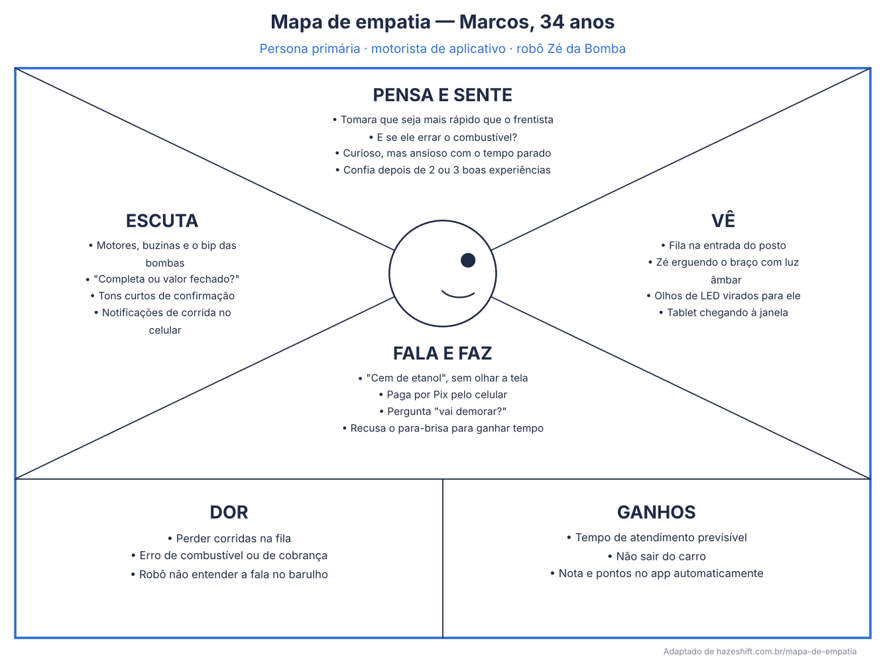
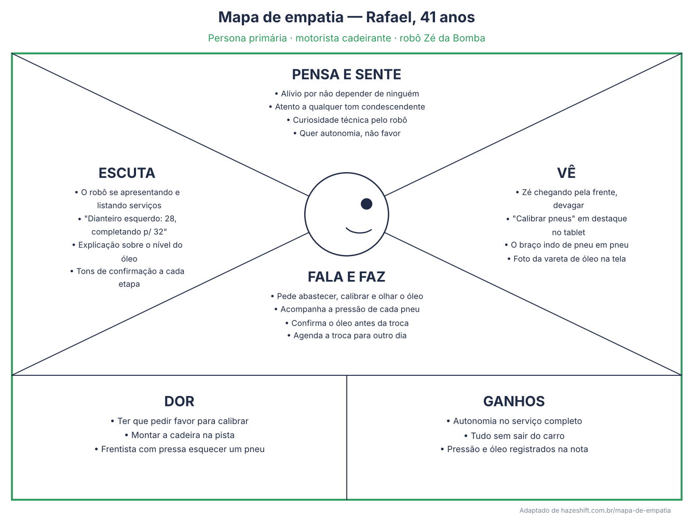
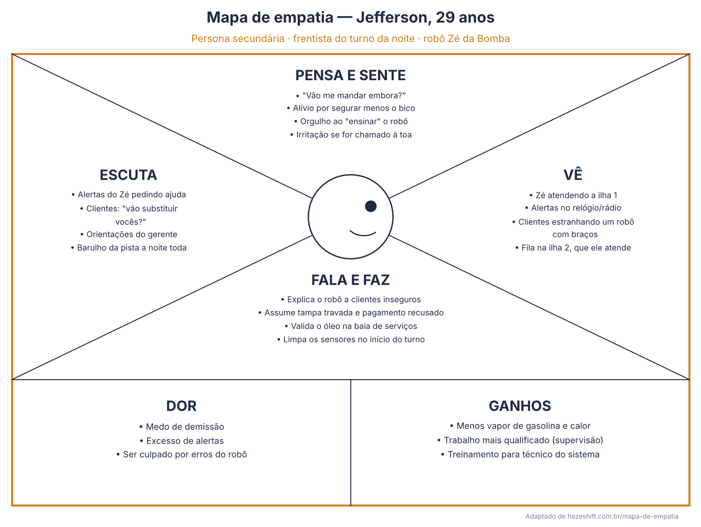
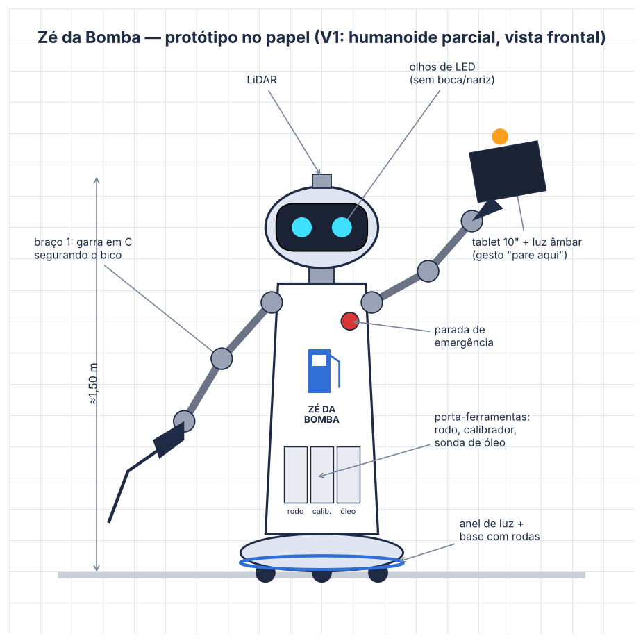
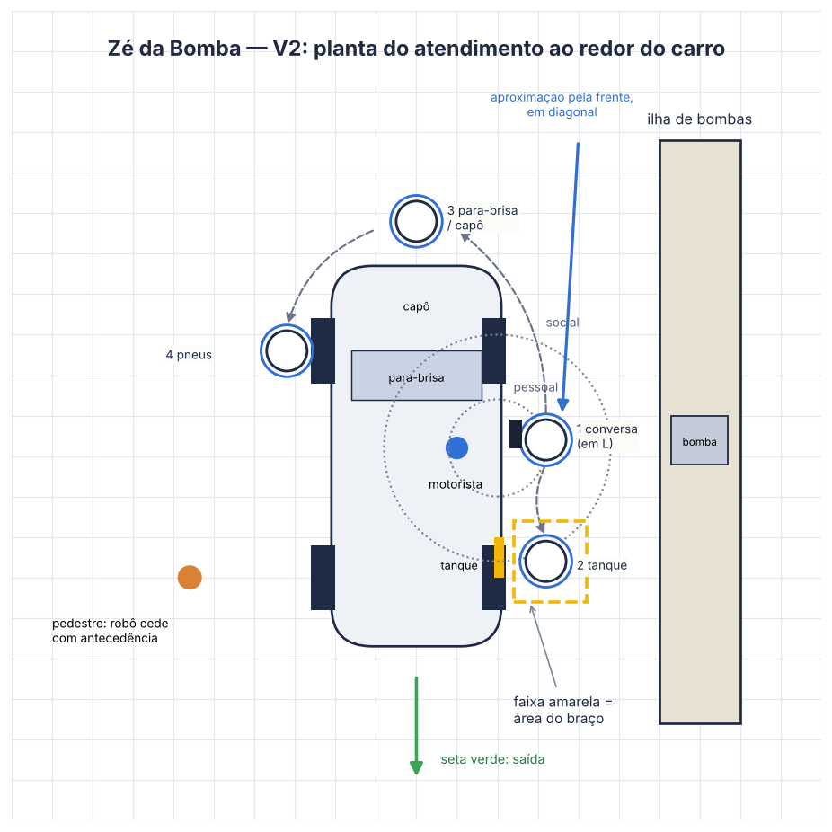
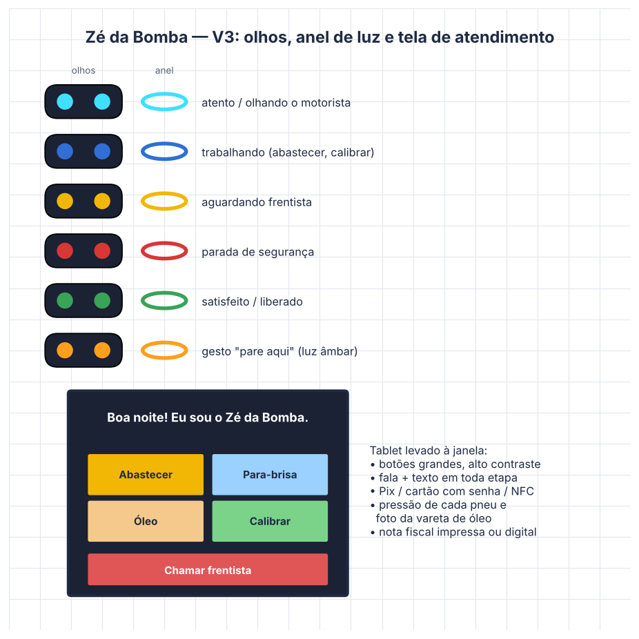

# **Zé da Bomba:** Robô frentista humanoide para postos de combustível

Trabalho de Interação Humano-Robô (IHR) apresentado ao Centro Universitário [FEI](https://portal.fei.edu.br/), como parte dos requisitos necessários para aprovação na disciplina de Interação Humano-Robô (IHR) (CCR230) do curso de Engenharia de Robôs, orientado pelo Prof. Dr. [Fagner de Assis Moura Pimentel](https://github.com/fagnerpimentel).

## Componentes do Grupo

- Nome - RA
- Nome - RA
- Nome - RA

## Resumo

O Zé da Bomba é um robô frentista humanoide parcial, com cabeça, tronco e dois braços sobre uma base móvel com rodas, que trabalha na pista de um posto de combustível ao lado dos frentistas humanos. Com um sistema de segurança em várias camadas, ele abastece o veículo, limpa o para-brisa, verifica o nível de óleo e faz a troca na baia de serviços, calibra os pneus (atendendo principalmente motoristas com deficiência ou mobilidade reduzida, que não conseguem sair do carro) e recebe o pagamento com emissão de nota fiscal. Pedidos fora do roteiro e exceções são repassados a um frentista, que supervisiona o robô.

## Introdução

No Brasil, abastecer o carro é um serviço feito por outra pessoa: a Lei nº 9.956/2000 proíbe bombas de autosserviço operadas pelo próprio consumidor, e o frentista faz parte da cultura do posto ("Completa?", "Gasolina ou etanol?", "Quer que dê uma olhada no óleo?"). A função, porém, tem problemas conhecidos: exposição diária a vapores de gasolina com benzeno (substância cancerígena regulada pela NR-15, Anexo 13-A), jornadas longas de madrugada, trabalho em pé sob sol e chuva, alta rotatividade e filas nos horários de pico. Para quem dirige, também há barreiras: motoristas com deficiência ou mobilidade reduzida dependem de terceiros para calibrar os pneus ou conferir o óleo, já que esses serviços costumam exigir sair do carro.

O Zé da Bomba é um robô móvel de cerca de 1,50 m, com forma humana parcial: uma cabeça com dois "olhos" de LED que indicam para onde ele está olhando, dois braços articulados com garras e ferramentas trocáveis e um tablet que ele aproxima da janela do motorista. Ele se desloca ao redor do carro para fazer cada serviço, conversa com o motorista em um roteiro fechado e usa gestos parecidos com os de um frentista (apontar onde parar, sinalizar "pode vir" e "pare"). Ele não substitui a equipe: assume as tarefas repetitivas e insalubres, enquanto o frentista humano supervisiona e cuida dos casos que dependem de julgamento.

**Objetivo em uma frase:** prestar os serviços de pista de um frentista (abastecimento, para-brisa, óleo, calibragem e pagamento) de forma rápida, segura e acessível, sem que o motorista precise sair do carro.

**Experiência desejada:** cordial e previsível, com o "jeitão" de um bom frentista de bairro, transmitindo segurança e paciência, especialmente para quem tem dificuldade de mobilidade ou pouca familiaridade com tecnologia.

## Público-Alvo e Stakeholders

Motoristas de veículos leves (carros de passeio e utilitários; motos e caminhões ficam fora da primeira versão) que abastecem em postos urbanos da Grande São Paulo. O público é amplo: motoristas de aplicativo e entregadores que abastecem quase todo dia, famílias, idosos e motoristas com deficiência ou mobilidade reduzida, que hoje dependem de ajuda para os serviços fora do carro.

### Stakeholders

- **Primários** — motoristas que param na pista, fazem o pedido, são atendidos e pagam ao robô.
- **Secundários** — frentistas e gerente do posto, que supervisionam o robô, assumem exceções (tampa travada, pagamento recusado, cliente irritado), validam o óleo na troca e fazem a limpeza e a checagem diária; técnicos de manutenção da empresa fornecedora.
- **Terciários** — dono do posto e distribuidora (custo, imagem da marca); Sindicato dos Frentistas (Sinpospetro), preocupado com empregos; ANP, Corpo de Bombeiros e Inmetro (segurança em área com atmosfera explosiva); motoristas na fila, pedestres que passam pela pista indo à loja de conveniência e moradores do entorno.

### Personas

- **Persona primária — Marcos, 34 anos:** motorista de aplicativo em São Bernardo do Campo, trabalha 10 h por dia e abastece etanol quase diariamente, sempre com valor fechado ("R$ 100 de etanol"). Paga por Pix ou pelo app do posto para acumular pontos. Mora com a esposa e um filho pequeno, com renda variável; cada minuto na fila é corrida perdida. Gosta de tecnologia, mas é impaciente com sistemas que "travam". O robô deve saber antes de começar: tipo de combustível do veículo (pelo cadastro opcional da placa ou pela pergunta), forma de pagamento preferida e se pede nota no CPF.
- **Persona primária — Rafael, 41 anos:** analista de sistemas, usuário de cadeira de rodas desde um acidente aos 25 anos. Dirige um carro adaptado com comandos manuais e mora sozinho. Para calibrar os pneus ou conferir o óleo, hoje depende da boa vontade do frentista ou de parentes, porque montar e desmontar a cadeira para sair do carro leva vários minutos. Valoriza autonomia e se incomoda com atendimento infantilizado. O robô deve saber: que ele prefere não sair do carro, que quer calibrar e conferir óleo junto com o abastecimento e a calibragem indicada para o carro dele (cadastro ou etiqueta da porta).
- **Persona primária — Dona Lúcia, 68 anos:** professora aposentada, dirige um compacto 2012 e abastece gasolina comum a cada duas semanas. Tem artrose no joelho e prefere não sair do carro. Gosta de conversar com o frentista conhecido, desconfia de pagar por aproximação e usa cartão de débito com senha. Não sabe onde fica o botão da portinhola do tanque. O robô deve saber: se ela precisa de mais tempo nas telas, se prefere fala ou toque e quando chamar um humano.
- **Persona secundária — Jefferson, 29 anos:** frentista há 8 anos, no turno da noite, com ensino médio completo. Tem medo de perder o emprego para o robô, mas gostaria de parar de sentir cheiro de gasolina o dia todo. Conhece os clientes fixos e resolve os problemas. O robô deve saber: quem é o frentista de plantão, como chamá-lo (alerta no relógio/rádio) e quais tarefas ele assumiu.
- **Outra persona — Sr. Paulo, 55 anos, dono do posto:** quer reduzir filas e afastamentos médicos e atrair clientes com o serviço acessível, mas não quer conflito com o sindicato nem perder clientes antigos.

### Mapa de empatia

Mapas de empatia[^1] de duas personas primárias (Marcos e Rafael) e uma secundária (Jefferson), no formato do quadro de empatia da disciplina. Abaixo de cada imagem, o mesmo conteúdo em texto.

**Persona primária: Marcos (motorista de aplicativo)**

- **Vê:** a fila na entrada do posto, o painel de preços, o Zé da Bomba erguendo o braço com luz âmbar para indicar onde parar, os "olhos" de LED virados para ele, o tablet chegando à janela, o app de corridas no celular.
- **Ouve:** motores, buzinas, o "bip" das bombas, a voz do robô ("Completa ou valor fechado?"), os tons curtos de confirmação, o rádio do carro.
- **Diz e faz:** fala "cem de etanol" sem olhar direito para a tela, aproxima o celular para pagar por Pix, pergunta "vai demorar?", tamborila no volante, às vezes recusa a limpeza do para-brisa para ganhar tempo.
- **Pensa e sente:** "tomara que seja mais rápido que o frentista", "e se ele errar o combustível?"; curiosidade, ansiedade com o tempo parado, desconfiança na primeira vez e confiança depois de duas ou três boas experiências.
- **Dores:** perder corridas na fila; erro de combustível; cobrança errada; o robô não entender o que ele fala com o barulho.
- **Ganhos:** abastecer em tempo previsível; não sair do carro; comprovante e pontos no app automaticamente; ver exatamente quanto foi colocado.

**Persona primária: Rafael (motorista cadeirante)**

- **Vê:** o robô se aproximando devagar pela frente do carro, a tela com a opção "Calibrar pneus" em destaque, o braço do robô indo de pneu em pneu.
- **Ouve:** o robô se apresentando e perguntando quais serviços ele quer; a leitura da pressão de cada pneu ("Dianteiro esquerdo: 28 libras, vou completar para 32").
- **Diz e faz:** pede abastecimento, calibragem e verificação do óleo de uma vez; acompanha pelo tablet a pressão de cada pneu; confirma o tipo de óleo antes da troca.
- **Pensa e sente:** alívio por não depender de ninguém; atenção a qualquer sinal de tratamento condescendente; curiosidade técnica sobre como o robô funciona.
- **Dores:** ter que pedir favor para calibrar; montar a cadeira na pista; frentista com pressa que "esquece" um pneu.
- **Ganhos:** autonomia; serviço completo sem sair do carro; registro da pressão e do nível de óleo no comprovante.

**Persona secundária: Jefferson (frentista)**

- **Vê:** o robô atendendo a ilha 1 enquanto ele atende a ilha 2; alertas do robô no relógio; clientes estranhando um robô "com braços".
- **Ouve:** alertas sonoros pedindo ajuda; comentários de clientes ("vão mandar vocês embora?"); orientações do gerente.
- **Diz e faz:** explica o robô a clientes inseguros, assume quando a tampa trava ou o pagamento falha, valida o óleo na baia de serviços, limpa os sensores no início do turno.
- **Pensa e sente:** insegurança com o emprego; alívio por segurar menos o bico; orgulho ao "ensinar" o robô; irritação se o robô chamar por qualquer coisa.
- **Dores:** medo de demissão; excesso de alertas; ser responsabilizado por erros do robô.
- **Ganhos:** menos exposição a vapores e calor; trabalho mais qualificado (supervisão, atendimento); treinamento e possibilidade de virar técnico do sistema.

## Contexto de uso

Posto urbano de bandeira em avenida movimentada de São Bernardo do Campo (SP), aberto 24 h, com 4 ilhas de bombas, uma baia de serviços (troca de óleo) e loja de conveniência. O Zé da Bomba atende uma ilha (os dois lados) e a baia de serviços; os frentistas humanos atendem as demais ilhas e supervisionam o robô.

O ambiente é externo e coberto, mas sujeito a chuva com vento, sol forte, poeira e grande variação de luz (sol do meio-dia, faróis à noite). É ruidoso (motores, buzinas, trânsito) e classificado como área com atmosfera potencialmente explosiva, o que exige equipamentos certificados (Ex/Inmetro), aterramento e ausência de faíscas. Há carros em movimento, pedestres atravessando a pista e, às vezes, crianças e animais nos carros.

Socialmente, o posto é um lugar de passagem rápida, mas também de relação: clientes fixos conhecem os frentistas pelo nome, e a conversa e a gorjeta fazem parte do atendimento. Economicamente, o público vai de motoristas de aplicativo, sensíveis a preço e tempo, a clientes de maior renda que valorizam conforto. Culturalmente, o brasileiro espera ser atendido e não está habituado a abastecer sozinho.

Antes de iniciar a tarefa, o robô precisa saber: preços e combustíveis de cada bico e se algum está bloqueado; estoque e especificação dos óleos da baia; quem é o frentista de plantão e como chamá-lo; posição do veículo e lado da portinhola; pressão recomendada para o modelo (cadastro ou etiqueta da porta); formas de pagamento ativas (Pix, cartão, app de fidelidade); e se há chuva forte ou alerta de segurança que exija suspender o atendimento automático.

## Jornada do usuário

1. Rafael entra no posto às 18 h. O Zé da Bomba, na ponta da ilha, ergue o braço com a luz âmbar acesa e aponta a posição de parada; uma faixa projetada no chão mostra onde o carro deve ficar *(não-verbal + espacial)*.
2. Rafael para e desliga o motor. O robô espera o carro parar totalmente e se aproxima pela frente, em diagonal e devagar, até ficar a cerca de 1,2 m da porta, virando a cabeça para a janela *(espacial + não-verbal)*.
3. Ele estende o braço com o tablet até cerca de 50 cm da janela e diz: "Boa tarde! Eu sou o Zé da Bomba, assistente de pista. Pode me chamar de Zé. Eu abasteço, limpo o para-brisa, confiro o óleo e calibro os pneus. Para outras coisas, chamo o Jefferson." *(verbal — introdução inicial)*.
4. Rafael toca em "Completar etanol", "Calibrar pneus" e "Verificar óleo". O robô repete o pedido em voz alta e mostra o resumo na tela; Rafael confirma *(verbal + toque)*.
5. O robô pede para destravar a portinhola e mostra na tela onde fica o botão naquele modelo *(verbal — comunicação didática)*. A cabeça "olha" para o tanque, o anel da base fica azul e a faixa no chão marca a área do braço; o robô insere o bico *(não-verbal + espacial)*.
6. Durante o abastecimento, o braço livre limpa o para-brisa. Um pedestre se aproxima da área marcada: o robô pausa o braço e diz "Por favor, aguarde fora da faixa amarela" *(espacial + verbal)*.
7. O robô vai até cada pneu, sempre contornando o carro pela frente, informa a pressão lida e completa até o valor recomendado ("Dianteiro esquerdo: 28 libras, completando para 32") *(verbal + espacial)*.
8. Ele pede para Rafael abrir o capô pela alavanca interna, confere a vareta com a câmera e mostra a imagem na tela: "O óleo está perto do mínimo. Quer fazer a troca agora na baia ao lado? Leva cerca de 15 minutos." Rafael prefere agendar; o robô registra *(verbal + comunicação didática)*.
9. O robô fecha o capô e a tampa do tanque, pede para fechar a portinhola e mostra o QR Code do Pix. Rafael paga; o robô emite a nota com a pressão dos pneus e o nível de óleo *(verbal + toque)*.
10. "Pagamento aprovado. Boa viagem, Rafael!" O robô recolhe o tablet, dá um passo para trás, inclina levemente o tronco e aponta a saída; o anel fica verde *(verbal + não-verbal + espacial)*.
11. **Exceção:** se Dona Lúcia não encontrar o botão da portinhola depois de duas tentativas guiadas, o robô diz "Vou chamar o Jefferson para ajudar, só um instante", deixa os olhos e o anel em amarelo e espera o humano.

## Análise de concorrência

- **Autofuel (Dinamarca)** — braço robótico embutido na bomba, testado em posto da Neste na Finlândia, que reconhece a placa, abre a tampa e abastece sem intervenção humana. *Pontos positivos:* abastecimento automático, motorista não sai do carro, útil para pessoas com deficiência. *Pontos negativos:* exige cadastro prévio do veículo e, em algumas versões, tampa especial; só abastece (não calibra, não limpa, não confere óleo); quase não há interação social.
- **Rotec Tank Pitstop (Holanda)** — um dos primeiros sistemas de abastecimento robótico, com braço em quiosque que para ao detectar anomalias, como uma criança por perto. *Pontos positivos:* pioneiro e com foco em segurança. *Pontos negativos:* incorporado comercialmente pela Autofuel; estrutura grande; interação apenas por tela.
- **Pepper (SoftBank Robotics)** — humanoide parcial usado em recepção e varejo. Plataforma diferente quanto ao serviço, mas é a referência de forma e de interação social que o Zé da Bomba adota. *Pontos positivos:* forma amigável, olhos de LED, tablet no peito, boa aceitação pública. *Pontos negativos:* não manipula objetos pesados, não é certificado para atmosfera explosiva e cria expectativa de conversa livre.
- **Apps de pagamento dos postos (ex.: Shell Box, Abastece Aí)** — atendem o mesmo mercado com outro serviço: pagamento pelo celular. *Pontos positivos:* rápido, sem hardware novo, acumula pontos. *Pontos negativos:* não fazem nenhum serviço físico e dependem de celular com internet.

A equipe considera o **Autofuel** a referência mais próxima quanto à tarefa e o **Pepper** a referência quanto à forma e à interação. O diferencial do Zé da Bomba é unir as duas coisas: um robô que faz todos os serviços de pista e se comunica como um frentista, sob supervisão humana.

## Design do Robô

> As respostas da primeira atividade do projeto (aula de Design de Robôs: função, morfologia, affordances, padrões de design e dimensões da semelhança humana) estão em [`docs/Projeto_Humano-Robo.docx`](docs/Projeto_Humano-Robo.docx).

### Forma, função e affordances

O Zé da Bomba tem cerca de 1,50 m (altura da janela e do capô) e é composto por:

- **Base móvel omnidirecional** com rodas e certificação para área classificada, anel de luz na borda e projetor que desenha no chão a área de trabalho.
- **Tronco** branco e azul nas cores do posto, com o nome "Zé da Bomba" e o desenho de uma bomba de combustível, botão de emergência vermelho e a "barriga" funcionando como porta-ferramentas (rodo/borrifador, calibrador, sonda de extração de óleo).
- **Cabeça** com câmeras e LiDAR atrás de um visor escuro, onde aparecem **dois olhos de LED** que se movem, piscam e mudam de cor. Não há boca, nariz nem pele.
- **Dois braços** com ombro, cotovelo e punho e **garras mecânicas** com acoplador de ferramentas: o braço direito manuseia o bico e a tampa do tanque; o esquerdo segura o tablet e as ferramentas.
- **Tablet de 10"** com leitor de cartão/NFC, câmera, microfone direcional e impressora de nota fiscal na base; antena Wi-Fi para pagamento e integração com o sistema do posto.

**Affordances visuais/estruturais:** a garra e o acoplador evidentes sinalizam que o robô empunha a pistola de combustível e destrava a tampa; os olhos de LED e o anel luminoso mostram para onde ele está olhando, garantindo ao motorista que o veículo e a portinhola estão sendo monitorados; o tablet sinaliza interação por toque; as ferramentas expostas mostram quais serviços ele faz; o receptor de pagamento e o emissor de nota mostram que ele também cobra.

**Affordances comportamentais/auditivas:** braço erguido com luz âmbar indica onde alinhar o veículo; tons curtos confirmam ações (início do fluxo, fim do abastecimento, liberação, pagamento aprovado), reduzindo a dependência de fala; alto-falante e microfones indicam que ele conversa; a cabeça vira para o ponto onde vai agir antes de cada movimento.

**Acessibilidade:** todos os serviços são feitos sem o motorista sair do carro (calibragem e óleo pensados para pessoas com deficiência ou mobilidade reduzida); fontes grandes, alto contraste e modo "mais tempo" no tablet; informação sempre falada e escrita (para pessoas surdas ou cegas); pagamento com senha, NFC ou Pix; botão "Chamar frentista" sempre visível.

**Combinar forma e função / prometer menos e entregar mais:** os braços existem porque o robô manipula objetos, e os olhos, porque ele enxerga; mas a forma humana gera a expectativa de que ele converse e pense como uma pessoa. Por isso ele é apresentado como "assistente de pista", e não como "frentista inteligente", e diz na apresentação o que faz e o que repassa ao humano. Assim, o cliente se surpreende com a rapidez e o cuidado em vez de se frustrar com uma conversa limitada.

### Grau de antropomorfismo

Morfologia: **humanoide parcial** (categoria androides e humanoides), na linha do Pepper e do Nao: cabeça, tronco e dois braços, sem pernas, sem pele e sem rosto realista. No espectro máquina ↔ humano, o Zé da Bomba fica **no meio, um pouco mais perto da máquina**.

**Justificativa:** o trabalho do frentista é corporal (segurar o bico, abrir o capô, ir até os pneus, apontar onde parar), e a forma humana parcial torna os gestos do robô imediatamente legíveis, porque são os mesmos de um frentista. Pessoas que nunca viram um robô entendem "braço erguido = pare aqui". Também ajuda na aceitação de clientes que valorizam o atendimento "de gente", como Dona Lúcia. Por outro lado, a tarefa envolve combustível inflamável e dinheiro, então a aparência precisa transmitir precisão; um androide realista criaria expectativas de conversa e julgamento humanos que o robô não cumpre.

**Como evitar o vale da estranheza:** o robô não tem pele, boca, nariz nem expressões faciais; os "olhos" são pontos de LED; as garras são assumidamente mecânicas; os movimentos são suaves, mas não imitam microgestos humanos; a voz é cordial, porém claramente sintética. Seguindo o princípio de **não misturar metáforas**, aparência, voz e comportamento são todos de um "robô assistente", sem partes humanas realistas misturadas a partes mecânicas.

### Padrões de design

- **Introdução inicial:** o Zé da Bomba se apresenta assim que o carro para, dizendo o nome, o que faz e o que repassa ao frentista.
- **Comunicação didática:** o robô explica em linguagem simples o que vai fazer e o que o cliente precisa fazer ("O botão da portinhola fica à esquerda do banco"; "O óleo está perto do mínimo"), mostrando a imagem no tablet.
- **Padrão de movimento (apoio):** o robô inicia o movimento e se alinha com o veículo, apontando onde parar e indo de um serviço a outro de forma previsível.

**Como se combinam:** a introdução inicial ajusta as expectativas (prometer menos), a comunicação didática conduz o cliente em cada etapa e o padrão de movimento organiza o espaço. Juntos, formam o padrão composto de **"frentista guia"**: o robô se apresenta, explica, conduz e devolve ao humano o que sai do roteiro.

### Dimensões da semelhança humana

**Físicas (forma e aparência):**

- Cabeça com dois olhos de LED que indicam atenção e mudam de cor para expressar estados (como no Nao), sem boca nem nariz.
- Tronco e dois braços com ombro, cotovelo e punho, que permitem gestos de frentista (apontar, acenar, "pode vir", "pare").
- "Mãos" mecânicas: garras e ferramentas expostas, que não imitam mãos humanas.
- Altura de cerca de 1,50 m, com base com rodas no lugar de pernas.
- Carcaça branca e azul, sem pele sintética nem rosto realista.

**Comportamentais:**

- **Olhar contingente:** vira a cabeça para quem fala, buzina ou acena (velocidade de reação) e mantém o olhar só quando o estímulo é relevante, desviando de movimentos irrelevantes (contingência).
- **Gestos e postura:** chamar, parar, apontar o tanque, se despedir; leve inclinação do tronco ao cumprimentar e ao se despedir.
- **Fala e turnos:** voz adulta cordial, roteiro fechado com expressões de posto e alternância de turnos com marcadores curtos.
- **Expressão emocional contida:** cor e ritmo dos olhos expressam estados simples (satisfeito, aguardando, alerta).

Com isso, o cliente atribui atenção e intenção ao robô (antropomorfismo psicológico), o que facilita a cooperação ("ele está esperando eu abrir a portinhola"), sem que o Zé da Bomba pareça uma pessoa.

### Valores e ética

**Valores (VSD):**

- **Segurança** — de clientes, pedestres e trabalhadores em uma área com combustível. O sistema de segurança tem camadas: detecção de pessoas e animais na área de trabalho com pausa imediata do braço; velocidade e força limitadas, como em robôs colaborativos; abastecimento só com motor desligado (confirmado pelo cliente e pelo som/vibração); verificação do bico escolhido antes da inserção; detecção de vazamento e de chama/cigarro; botão de emergência físico; equipamentos certificados para atmosfera explosiva; e um frentista humano como supervisor final.
- **Inclusão e autonomia** — o robô amplia o atendimento a motoristas com deficiência ou mobilidade reduzida sem tratá-los de forma diferente na interação: a calibragem e a verificação de óleo aparecem para todos no menu, com o mesmo tom, e o cadastro de preferências é opcional.

**Privacidade:** as câmeras veem portinhola, pneus, capô e janela; as imagens são processadas no robô e não são gravadas, não há reconhecimento facial e a leitura da placa só ocorre para quem se cadastra no programa de fidelidade, com aviso visível na entrada (LGPD).

**Risco ético:** um robô com forma humana reforça a percepção de "máquina que substitui o frentista", afetando uma categoria de baixa renda protegida pela Lei nº 9.956/2000 e pela garantia constitucional de proteção do trabalhador frente à automação (art. 7º, XXVII). **Mitigação:** o Zé da Bomba é projetado como cobot: atende uma ilha e a baia de serviços sempre sob supervisão de um frentista, que valida exceções, aprova o óleo da troca e pode assumir a qualquer momento. O plano de implantação prevê requalificação dos frentistas como supervisores do sistema e atendentes de serviços, não redução do quadro, e usa os ganhos de saúde (menos exposição ao benzeno) como argumento junto ao sindicato.

### Protótipo no papel

Modelo em formas primitivas:

- **Base:** cilindro baixo e largo (Ø 0,70 m × 0,25 m) sobre rodas, com um anel de luz na borda e uma faixa tracejada no chão (área projetada).
- **Tronco:** cilindro levemente afunilado (≈0,80 m), com o nome "Zé da Bomba", o desenho de uma bomba de combustível e o botão de emergência.
- **Cabeça:** esfera achatada (Ø 0,30 m) com visor escuro e dois círculos de LED (olhos), mais um pequeno cilindro de LiDAR no topo.
- **Braços:** dois conjuntos de cilindros (segmentos) e esferas (ombro, cotovelo e punho); o direito termina em garra em "C" segurando o bico, e o esquerdo, em garra segurando o tablet (retângulo).
- **Porta-ferramentas:** pequenos retângulos na frente do tronco (rodo, calibrador, sonda).

Altura total ≈1,50 m; alcance de cada braço ≈1,0 m; velocidade máxima na pista ≈0,5 m/s.

As imagens abaixo são os esboços em formas primitivas (V1: vista frontal anotada; V2: planta do atendimento ao redor do carro, com zonas de proxêmica; V3: estados dos olhos e do anel de luz e tela de atendimento). Prompts para gerar versões ilustradas/renderizadas com IA estão em [`prompt_imagem_robo.md`](prompt_imagem_robo.md).

  

## Ações do robô

**1. Receber o veículo e orientar o posicionamento** — ergue o braço com luz âmbar, aponta e projeta no chão onde o carro deve parar. *Pré-requisitos:* faixa livre; nenhum veículo em movimento na área de trabalho; robô na posição de espera. *Ao finalizar:* carro parado na posição certa e robô ao lado da porta do motorista.

**2. Coletar o pedido** — apresenta-se, pergunta os serviços (combustível e quantidade, para-brisa, óleo, calibragem) e a forma de pagamento; confirma em voz e no tablet. *Pré-requisitos:* motor desligado; tablet na janela; pedido compatível com os bicos e serviços disponíveis. *Ao finalizar:* pedido registrado no sistema do posto e bico correto liberado.

**3. Abastecer** — localiza a portinhola aberta, gira a tampa, insere o bico, abastece e monitora vazão e entorno. *Pré-requisitos:* portinhola destravada pelo motorista; bico conferido; ninguém na área de trabalho; sem chuva forte ou alerta de segurança. *Ao finalizar:* tanque com a quantidade pedida, bico de volta à bomba, tampa fechada e litros/valor registrados.

**4. Limpar o para-brisa** — borrifa e passa o rodo, de baixo para cima e de um lado ao outro, com o braço livre durante o abastecimento. *Pré-requisitos:* cliente aceitou o serviço; limpador do carro desligado; braço com a ferramenta acoplada. *Ao finalizar:* para-brisa limpo, sem resíduo, e ferramenta de volta ao porta-ferramentas.

**5. Verificar o nível de óleo** — pede para abrir o capô, retira a vareta, limpa, mede, mostra a imagem no tablet e informa o resultado. *Pré-requisitos:* motor desligado há alguns minutos; capô destravado pelo motorista; cliente aceitou o serviço. *Ao finalizar:* vareta recolocada, capô fechado e nível informado e registrado na nota.

**6. Trocar o óleo** — na baia de serviços, extrai o óleo usado por sucção pelo tubo da vareta, coloca o óleo novo indicado para o modelo e confere o nível. *Pré-requisitos:* carro na baia; tipo e quantidade de óleo validados pelo frentista; cliente aceitou o valor. *Ao finalizar:* óleo trocado, óleo usado no recipiente de descarte correto, etiqueta de troca no para-brisa e registro no sistema.

**7. Calibrar os pneus** — vai até cada pneu, acopla o calibrador, informa a pressão e completa até o valor recomendado, incluindo o estepe se pedido. *Pré-requisitos:* pressão recomendada conhecida (cadastro, etiqueta ou informada pelo cliente); carro parado e freado; nenhuma pessoa entre o robô e o pneu. *Ao finalizar:* pneus na pressão indicada e valores registrados na nota.

**8. Receber o pagamento e emitir a nota** — mostra o valor total, aceita Pix, cartão com senha, NFC ou app; emite nota fiscal (impressa ou digital). *Pré-requisitos:* serviços concluídos; conexão com o sistema de pagamento. *Ao finalizar:* venda fechada, nota entregue e pontos creditados quando houver cadastro.

**9. Liberar o veículo** — recolhe o tablet, dá um passo para trás, se despede e aponta a saída. *Pré-requisitos:* pagamento aprovado; braços e ferramentas recolhidos. *Ao finalizar:* carro sai da faixa e o robô volta à posição de espera.

**10. Chamar o frentista humano** — envia alerta ao relógio/rádio do frentista e avisa o cliente. *Pré-requisitos:* pedido fora do escopo, falha (tampa travada, pagamento recusado, óleo incompatível) ou pedido do cliente. *Ao finalizar:* o frentista assume aquela etapa e o robô registra o motivo.

**11. Parada de segurança** — interrompe o fluxo, recolhe os braços e se afasta do carro. *Pré-requisitos:* pessoa ou animal na área de trabalho, motor ligado durante o abastecimento, chama ou cigarro, vazamento ou botão de emergência acionado. *Ao finalizar:* bomba bloqueada, robô em posição segura e alerta enviado ao frentista e ao gerente.

## Interações do robô

### Espacial

- **Posicionamento:** durante a conversa, o robô fica a cerca de 1,2 m da porta do motorista, na **zona social** próxima (considerando o carro como extensão do espaço pessoal); só o tablet entra na **zona pessoal** (≈50 cm da janela), e apenas com o carro parado e o vidro aberto. Ao trabalhar no tanque, no capô ou nos pneus, fica encostado no carro, mas fora do campo do motorista.
- **F-formation:** na conversa, robô e motorista formam uma **formação em L** (corpo do robô na diagonal da janela), com o o-space na região da janela. Quando o frentista participa, forma-se uma configuração **circular** (motorista, robô e frentista), e o robô gira o corpo inteiro, não só a cabeça, para incluir o frentista, o que é mais eficaz para reorganizar a formação.
- **Início da aproximação:** o robô espera o carro parar totalmente e se aproxima **pela frente, em diagonal**, dentro do campo de visão do motorista, reduzindo a velocidade a 2 m da porta. Nunca chega por trás, pelo ponto cego.
- **Sinalização de para onde vai:** antes de cada deslocamento, a cabeça vira para o destino (tanque, capô, pneu), e a faixa projetada no chão desenha a trajetória; o tablet mostra "Vou até o pneu traseiro".
- **Pessoas paradas, em conversa ou em grupo:** se o cliente sai do carro e fica conversando com o passageiro perto do tanque, o robô não passa entre eles: avisa, espera que se afastem da área marcada ou contorna pelo outro lado do carro. Pedestres indo à conveniência têm prioridade: o robô **cede com antecedência**, indica com a cabeça e a projeção o lado por onde vai passar e prevê a trajetória da pessoa em vez de reagir só à posição atual.

| Interação | Pré-requisitos | Resposta emocional esperada |
|---|---|---|
| Aproximação até a janela | Carro parado, motor desligado | Sentir-se atendido sem invasão; tranquilidade |
| Deslocamento ao redor do carro | Serviço confirmado; trajetória livre | Previsibilidade: o motorista sabe onde o robô está |
| Delimitação da área de trabalho | Braço prestes a se mover | Segurança |
| Ceder passagem ao pedestre | Pessoa na trajetória prevista | Respeito; percepção de que o robô "presta atenção" |
| Passo para trás e despedida | Pagamento aprovado | Encerramento claro e satisfação |

**Ajuste para outro contexto (madrugada, 0 h–5 h):** à noite, o motorista pode se sentir inseguro com qualquer aproximação. O robô se anuncia mais cedo (fala e luz assim que o carro entra na faixa), para a 1,5 m da porta, aproxima o tablet mais devagar e só até 80 cm da janela, permitindo pagar com o vidro parcialmente aberto. Serviços fora do carro (calibragem, óleo) são oferecidos, mas não insistidos.

### Verbal

**Interação restrita (FSM com árvore de diálogo).** O ambiente é muito ruidoso, o vocabulário é previsível ("completa", "cem de etanol", "calibra", "olha o óleo", "débito", "Pix", "nota no CPF") e a tarefa envolve dinheiro e segurança. Um LLM aberto, além de poder errar, reforçaria a expectativa criada pela forma humana de que o robô conversa sobre qualquer assunto. Perguntas fora do roteiro são encaminhadas ao frentista.

| Interação | Pré-requisitos | Resposta emocional esperada |
|---|---|---|
| Apresentação: "Boa noite! Eu sou o Zé da Bomba, assistente de pista. Eu abasteço, limpo o para-brisa, confiro o óleo e calibro os pneus." | Carro parado, tablet na janela | Acolhimento; entender o que o robô faz |
| Pedido: "Vai ser gasolina, etanol ou diesel? Completa ou valor fechado?" | Motor desligado | Rapidez e familiaridade |
| Confirmação: "Cem reais de etanol e calibragem, certo?" | Pedido reconhecido | Confiança de que não haverá erro |
| Explicação: "O botão da portinhola fica à esquerda do banco." | Portinhola fechada | Sentir-se ajudado, sem constrangimento |
| Informação de serviço: "Dianteiro esquerdo: 28 libras, completando para 32." | Calibragem em andamento | Transparência e controle |
| Aviso de segurança: "Por favor, aguarde fora da faixa amarela." | Pessoa na área de trabalho | Respeito, sem susto |
| Encaminhamento: "Isso o Jefferson faz melhor que eu. Já chamei." | Pedido fora do escopo | Ser ouvido, sem frustração |
| Despedida: "Pagamento aprovado. Boa viagem!" | Pagamento concluído | Satisfação |

**Timing:** com detecção de atividade vocal (VAD), o robô espera até 1,5 s de silêncio antes de considerar que o cliente terminou; enquanto processa, diz um marcador curto ("Certo...", "Um instante") e anima os olhos, evitando silêncio estranho. Respostas de sim/não são imediatas; durante os serviços, fala só no início, em eventos importantes e no fim. Sem resposta por 10 s, repete a pergunta uma vez e destaca os botões no tablet.

**Voz (TTS):** voz adulta, clara e cordial, de ritmo médio, com sotaque paulista neutro e expressões de posto. Combina com um robô de 1,50 m com forma humana: uma voz infantil não combinaria com quem manuseia combustível, e uma voz robótica demais contrastaria com os gestos humanos. TTS a bordo, para não depender da internet; volume ajustado ao ruído, com alto-falante direcional.

**Limitação do ASR:** motores, buzinas, chuva e o rádio do carro prejudicam o reconhecimento; sotaques e gírias ("cinquentinha de comum") variam. **Mitigação:** microfone direcional no tablet, perto da boca do motorista (*close miking*); cancelamento de ruído; vocabulário fechado com sinônimos regionais; confirmação por toque de toda escolha crítica (combustível, valor, serviços, pagamento); após duas falhas, o robô muda para "modo toque" e avisa o cliente.

### Não-verbal

**Canais escolhidos: olhar e gesto.**

| Interação | Descrição | Pré-requisitos | Resposta emocional esperada |
|---|---|---|---|
| Olhar de atenção | Os olhos de LED se voltam para o motorista enquanto ele fala e para o frentista quando este intervém | Pessoa detectada falando | Sentir-se ouvido |
| Olhar de intenção / atenção conjunta | Antes de agir, a cabeça olha para o tanque, o capô ou o pneu, e o motorista acompanha | Movimento prestes a começar | Previsibilidade e segurança |
| Gesto de "pare aqui" | Braço erguido com luz âmbar e palma da garra voltada para o carro | Carro chegando | Compreensão imediata, sem fala |
| Gesto dêitico | A garra aponta para o botão da portinhola ou para a saída | Portinhola fechada ou atendimento encerrado | Compreensão rápida |
| Gesto de despedida | Inclinação do tronco e aceno curto | Pagamento aprovado | Cordialidade |

**Percepção das pistas da pessoa:** a câmera do tablet detecta se o motorista olha para a tela (atenção) ou para o celular (distração); a câmera da cabeça reconhece gestos simples, como polegar para cima ("pode completar"), mão espalmada ("espera"), aceno chamando o frentista e o motorista apontando um pneu. Também detecta postura e movimento de pessoas ao redor (alguém saindo do carro, criança na janela).

**Falta de coordenação:** se o robô disser "Vou abastecer com etanol" mas a garra pegar o bico da gasolina, ou se olhar para o pneu enquanto diz "vou até o tanque", o cliente perde a confiança na hora e pode achar que houve erro. Outro caso: acenar "pode sair" com o bico ainda no tanque. Por isso, fala, olhar, gesto e tela são gerados a partir do mesmo estado da FSM, e o robô só se despede depois que os sensores confirmam braços e ferramentas recolhidos.

**Pista não verbal exclusiva do robô:** **projeção no chão** da área de trabalho e da trajetória (faixa amarela pulsante durante os serviços, vermelha em parada de segurança, seta verde para a saída), junto com o anel de luz da base. Não há equivalente humano direto, mas mostra a qualquer pessoa na pista, de longe, onde é seguro ficar.

## Emoção

**Modelo:** **dimensional PAD (prazer–ativação–dominância)**, extensão do modelo de Russell. No posto, o que mais importa é o nível de **ativação** do cliente (pressa, irritação, medo) e o **prazer** (satisfeito ou não), e não uma emoção básica específica. O modelo também facilita a expressão do robô sem rosto: o prazer aparece na cor dos olhos e no tom de voz, a ativação na velocidade do piscar e no ritmo da fala, e a dominância na firmeza da voz e da postura em avisos de segurança.

**Percepção do estado emocional do usuário:**

- **Voz:** tom, volume e velocidade (pressa e irritação aumentam volume e ritmo); análise de sentimento sobre o que foi dito.
- **Rosto e postura:** expressões básicas captadas pela câmera do tablet, processadas no robô, sem gravação; como esses algoritmos acertam pouco em expressões sutis, o rosto é combinado com o contexto.
- **Comportamento e contexto:** buzinar, tamborilar no volante, olhar para o relógio, tempo de espera na fila e falhas anteriores no atendimento.

**Quando mimetizar:**

- **Sim:** alegria e alívio (cliente satisfeito: tom mais animado, olhos em cor quente e pulso suave); bom humor de clientes conversadores, dentro do roteiro.
- **Não:** **raiva e impaciência** — retribuir raiva raramente ajuda, então o robô mantém ativação baixa, fala mais devagar, pede desculpas uma vez, informa o tempo restante e oferece chamar o frentista; **medo** — se o cliente tem receio dos braços, o robô não demonstra hesitação: afasta o tablet, explica o que vai fazer e oferece atendimento humano.

**Risco de gerenciamento de expectativas:** com forma humana e olhos que "reagem", o Zé da Bomba parece emocionalmente responsivo, e o cliente pode passar a esperar que ele siga outras normas sociais de um frentista: negociar desconto, ouvir reclamações sobre preço, conversar sobre o trânsito, reconhecer clientes antigos ou dar opinião sobre o carro. O robô não consegue cumprir essas expectativas. Por isso a expressão emocional é contida, a apresentação deixa claro o escopo e qualquer pedido social ou de negociação é encaminhado ao humano.

## Métodos de pesquisa

**Pergunta de pesquisa (confirmatória):** a apresentação inicial com escopo explícito ("eu abasteço, limpo, confiro o óleo e calibro; para o resto, chamo o frentista") aumenta a confiança e a satisfação dos motoristas e reduz pedidos fora do escopo, em comparação com uma apresentação apenas de cumprimento? *Hipótese:* sim, porque ajusta as expectativas geradas pela forma humanoide (prometer menos, entregar mais).

**Método:** estudo com usuários (experimento entre sujeitos), com protótipo operado por "mágico de Oz" em uma ilha de posto parceiro fora do horário de pico, com frentista ao lado. A variável independente é o tipo de apresentação (com escopo × sem escopo), sorteada por participante; o tipo de usuário (com ou sem deficiência) entra como fator quase experimental. Medidas: questionário com escala Likert e escala RoSAS (atributos sociais do robô), tempo de atendimento, número de pedidos fora do escopo e de chamadas ao frentista. Complementa-se com observação da interação e entrevista curta ao final.

**População e amostra:** motoristas de veículos leves da Grande São Paulo; amostra de conveniência entre clientes do posto parceiro, com cota de motoristas com deficiência recrutados por associações de pessoas com deficiência, para não depender só de quem aparece no posto. O tamanho da amostra é estimado com o G*Power para o efeito esperado.

**Cuidados éticos:** submissão ao Comitê de Ética em Pesquisa (CEP) da FEI; termo de consentimento livre e esclarecido antes da coleta; participação voluntária, com possibilidade de desistir a qualquer momento; segurança física (protótipo sem combustível real nas primeiras rodadas, frentista e botão de emergência sempre presentes); dados anonimizados, sem gravar rostos; devolução dos resultados aos participantes e às associações envolvidas.

---

## Referências

- BARTNECK, C. et al. *Human-Robot Interaction: An Introduction*. Cambridge University Press, 2020.
- KAHN, P. H. et al. Design patterns for sociality in human-robot interaction. HRI, 2008.
- MORI, M. The uncanny valley. *Energy*, 1970.
- EPLEY, N.; WAYTZ, A.; CACIOPPO, J. T. On seeing human: a three-factor theory of anthropomorphism. 2007.
- HALL, E. T. *The Hidden Dimension*. 1966.
- KENDON, A. *Conducting Interaction: Patterns of Behavior in Focused Encounters*. 1990.
- MEHRABIAN, A.; RUSSELL, J. A. *An Approach to Environmental Psychology*. 1974.
- FRIEDMAN, B.; KAHN, P. H.; BORNING, A. Value Sensitive Design and Information Systems. 2006.
- BRASIL. Lei nº 9.956, de 12 de janeiro de 2000. Proíbe o funcionamento de bombas de auto-serviço nos postos de abastecimento de combustíveis.
- BRASIL. Lei nº 13.709, de 14 de agosto de 2018 (LGPD).
- BRASIL. NR-15, Anexo 13-A (Benzeno) e NR-20 (Segurança com inflamáveis e combustíveis).
- AUTOFUEL. Sistema de abastecimento robótico (piloto em posto Neste, Finlândia).
- ROTEC ENGINEERING. Tank Pitstop System.
- SOFTBANK ROBOTICS. Pepper.

[^1]: Fonte do mapa de empatia: Adaptado de <https://hazeshift.com.br/mapa-de-empatia/>
